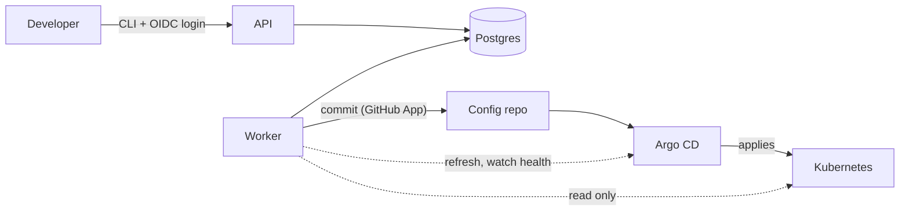

# deployctl

A small, shared deployment service for GitOps. Developers ask for a deploy, a scale or a rollback through a CLI (or the API). The service checks who they are and what they may do, records the request, then carries it out by committing to Git and letting Argo CD apply it.

> **Status:** early design. Nothing is implemented yet. The [docs](docs/) describe the intended behaviour.

```bash
$ deployctl deploy backend --env dev --tag e4f5a6b
✔ Request 0b8e created
✔ validate        a1b2c3d → e4f5a6b
✔ git_commit      pushed 3c2d1e0
✔ argocd_refresh
✔ wait_healthy    3/3 pods ready
✔ Deployed in 48s
```

## What it does

- **deploy:** change an app's image tag in the config repo and wait for a healthy rollout.
- **scale:** change an app's replica count the same way.
- **rollback:** restore the last successfully deployed tag, with a new commit.
- **status:** show sync state, health, image tag and replicas, live from Argo CD and Kubernetes.
- **Approvals:** production changes wait for a second person. Nobody can approve their own request.
- **Audit log:** every request, decision and outcome is recorded, append-only.
- **Live progress:** step-by-step updates streamed to the CLI.

It does **not** build images, create repos or clusters, manage secrets, or replace Argo CD.

## How it works



1. The **API** authenticates the user, authorizes the action, and records the request in Postgres. It holds no credential that can write to Git or the cluster.
2. The **worker** picks up the request's steps one at a time: validate, wait for approval (production only), commit the change, refresh Argo CD, wait until healthy, record the result.
3. **Argo CD** is the only thing that changes the cluster, and it only applies what is in Git.

Design principles: Git is the only write path · durable intent before side effects · every step idempotent · least privilege for people and software · guardrails, not gates · everything attributable.

## Documentation

| | |
|---|---|
| **[Learn](docs/learn/)** | New to Kubernetes, GitOps or cloud security? A story-driven walkthrough that follows a new developer through their first week, from containers to a production rollback. About two hours. |
| **[Reference](docs/reference/)** | The specification: [architecture](docs/reference/architecture.md), [request lifecycle](docs/reference/request-lifecycle.md), [security](docs/reference/security.md), [API](docs/reference/api.md), [CLI](docs/reference/cli.md), [configuration](docs/reference/configuration.md), [data model](docs/reference/data-model.md), [operations](docs/reference/operations.md), [development](docs/reference/development.md). |
| **[Decisions](docs/adr/)** | Architecture decision records: why it is built this way, and what was rejected. |

Start at the [docs index](docs/README.md) for reading paths by role.

## Quick start (planned)

```bash
cp deployctl.config.example.yaml deployctl.config.yaml
make db-up && make migrate
make api        # terminal 1, dev auth mode on :8080
make worker     # terminal 2
```

Prerequisites, a local cluster with Argo CD, and dev auth mode are covered in [development.md](docs/reference/development.md).

## Roadmap

| Milestone | Scope |
|---|---|
| M0 | Steps and clients (Git, Argo CD, Kubernetes, YAML editor), tested with fakes |
| M1 | API, worker, Postgres queue, deploy end to end in dev auth mode |
| M2 | OIDC auth and the central policy |
| M3 | Approvals and audit log |
| M4 | CLI client with login and live progress |
| M5 | Scale and rollback |
| M6 | Hardening: idempotency keys, rate limits, metrics, integration tests |

Details and done-criteria: [roadmap.md](docs/reference/roadmap.md).

## License

Choose a license (for example MIT) and add a `LICENSE` file.
