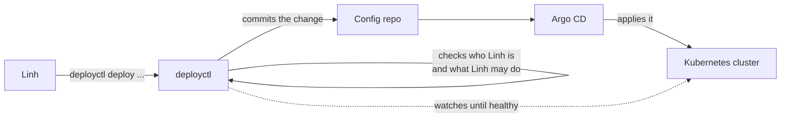

# 1. The problem

*Monday, 9:30.*

Linh's first task is small. Customers have reported that invoice totals are sometimes off by one cent. Linh finds the bug before lunch: the backend rounds each line item and then adds them up, instead of adding first and rounding once. A three-line fix, a test, a pull request. Priya reviews it and it is merged by noon.

Then Linh asks the question every new developer asks:

> "How do I get this running?"

Sam pulls up a chair. "Short answer: `deployctl deploy backend --env dev --tag <something>`. Long answer: let me tell you why that command exists, because the reasons explain everything about how it works."

## How deploys used to work

A year ago, the Reconcile team deployed like many small teams do.

Everyone had a file called a **kubeconfig** on their laptop. It contained the address of the Kubernetes cluster and a credential that let them do anything in it: start programs, stop them, read their secrets, delete them. To deploy, you ran a command like:

```bash
kubectl set image deployment/reconcile-backend backend=registry.example.com/reconcile-backend:e4f5a6b -n demo-prod
```

That tells the cluster: "the program called `reconcile-backend` should now run version `e4f5a6b`." It worked, and it was fast.

Then the team adopted a practice called **GitOps** (chapter 4 explains it fully). The short version: the description of what should run in the cluster now lives in a Git repository, the **config repo**, and a tool called **Argo CD** constantly makes the cluster match that repository. Deploying became "edit a file in the config repo and commit". That was better, because every change was now in Git history. But the old habits and the old credentials were still around.

## The Friday incident

Sam tells the story.

It was a Friday evening. A payment provider changed a date format, and the backend in production started rejecting payments. Alex, a developer who has since moved teams, wrote a fix, built it, and, in a hurry, used the old way:

```bash
kubectl set image deployment/reconcile-backend backend=...:hotfix1 -n demo-prod
```

Payments started flowing again. Alex went home.

**Three minutes later**, the bug was back.

Nobody understood why. Alex's terminal showed the command had succeeded. The cluster, when asked, said it was running the *old* version. Someone ran the command again. It worked, then three minutes later it was undone again. It took two hours to figure out: Argo CD was doing its job. The config repo still said the old version, so every few minutes Argo CD noticed the cluster no longer matched Git and put it back. It is called **self-healing**, and it is a feature.

When the team finally edited the config repo instead, they made a second mistake. Two people did it at the same time: Alex updated the image tag in the production values file, and Priya, on a call with Alex, increased the number of copies of the backend in the same file. Alex pushed first. Priya's push was rejected, Priya pulled, got a merge conflict in that file, and in a hurry resolved it by keeping their own version of the whole file, which still had the old tag. Production went back to the broken version for another twenty minutes.

On Monday, the post-incident review listed what had gone wrong:

1. **Too many people could change production directly**, with credentials that could do anything. Anyone with a kubeconfig could also read every secret in the cluster.
2. **There were two ways to change things** (the cluster directly, and Git), and they fought each other.
3. **No one had to look at a production change before it happened.** Under pressure, people skip steps.
4. **Concurrent edits to the same file** silently overwrote each other.
5. **There was no clear record** of who changed what and when. The cluster does not remember who ran `kubectl`. Git remembered commits, but commits were made from personal accounts with messages like "fix".
6. **Rollback meant digging** through Git history for the right old version, under pressure.
7. And a month later, an unrelated scare: a laptop was stolen. It had a kubeconfig with full admin rights to production. Nothing happened, but the team had to rotate every credential in the cluster.

## What the team wanted instead

Sam wrote down what a fix would need to provide. These became deployctl's design principles:

| Problem | What we want |
|---|---|
| Two ways to change things | **Git is the only write path.** Nothing changes the cluster except Argo CD applying Git. |
| Everyone holds powerful credentials | **Least privilege.** Developers hold no cluster or Git credentials at all. One small service holds a narrow one. |
| No review of production changes | **Guardrails, not gates.** Development environments need no permission. Production needs a second person to approve. |
| Concurrent edits | **One change at a time** per app and environment. A second one is refused, not merged. |
| No record | **Everything is attributable.** Every request, approval and outcome is logged with who did it, in a log that cannot be edited. |
| Hard rollbacks | **Rollback is a command.** deployctl remembers what was last deployed successfully. |
| Half-finished operations during outages | **Durable intent first.** Write down what you are going to do before doing it, so a crash can resume. |

## What deployctl is

deployctl is a small service that stands between developers and the config repo:



When Linh asks for a deploy:

1. deployctl checks who Linh is (they log in through the company's login system) and whether Linh is allowed to deploy to that environment.
2. It writes the request down in its database.
3. For production, it waits for someone other than Linh to approve.
4. It edits the right line in the right file in the config repo and commits, using its own narrowly scoped credential.
5. It tells Argo CD to look at the repo now, instead of in a few minutes.
6. It watches the cluster until the new version is running and healthy, and reports progress to Linh's terminal as it goes.
7. It records the result.

It does **not** build anything, does not change the cluster directly, and does not replace Argo CD. It is deliberately small.

"So," Sam says, "to understand what that one command does, you need to know four things: what is being deployed (containers and images), where it runs (Kubernetes), how it gets there (GitOps and Argo CD), and how deployctl knows it can trust you (identity and access). Let's start with the first one."

---

## Check yourself

<details>
<summary>1. In the Friday incident, why did Alex's fix disappear after three minutes?</summary>

Argo CD continuously compares the cluster to the config repo. Alex changed the cluster directly, but the config repo still described the old version. Argo CD saw the difference and changed the cluster back to match Git, which is called self-healing.
</details>

<details>
<summary>2. Why is "developers hold no cluster credentials" better, even for trusted developers?</summary>

Credentials can be stolen (the laptop), misused under pressure (the Friday incident), or used by mistake. If developers hold none, none of those can directly change production. It also forces every change through one path that is checked and recorded.
</details>

<details>
<summary>3. Which of the seven problems would a simple "edit the values file in the GitHub web UI" policy solve, and which would it not?</summary>

It would solve the two-paths problem (if cluster access were also removed) and give some history. It would not stop concurrent overwrites, would not require a second person (unless branch protection and reviews were set up), would not watch the rollout, and would not make rollback easy. Everyone would also still need write access to the repo that controls production.
</details>

Next: [2. Containers and images](02-containers-and-images.md)
