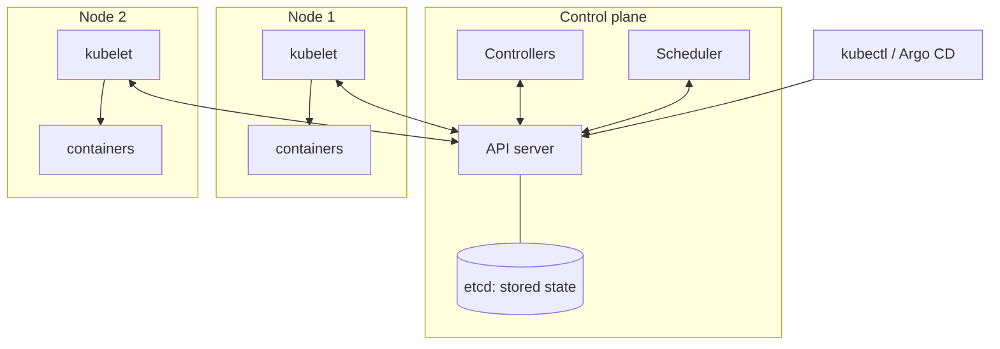

# 3. Kubernetes in an afternoon

*Monday, 14:15.*

Sam opens a terminal with read-only access to the dev cluster. "You won't get this access normally," Sam says. "deployctl means you don't need it. But seeing it once makes everything else make sense."

## What Kubernetes is for

Running one container on one machine is easy. Running a real app means:

- several copies of each part, so one crash does not take the app down,
- spread over several machines, so one machine failing does not either,
- restarted automatically when they crash,
- replaced one at a time when a new version ships, so there is no downtime,
- reachable at a stable address even as individual copies come and go.

**Kubernetes** does all of this. You give it a description of what you want ("three copies of `reconcile-backend:a1b2c3d`, each with 256 MB of memory"), and it makes that true and keeps it true.

A Kubernetes **cluster** is a set of machines called **nodes** that run containers, plus a **control plane**: an API server that stores the descriptions, and a set of programs that act on them.



Everything goes through the **API server**. `kubectl`, Argo CD and deployctl are all just clients of it.

## The most important idea: desired state and reconciliation

Kubernetes does not run commands. It stores **objects**, each describing a **desired state**, and runs **controllers** that each watch one kind of object and repeatedly do this:

```
loop forever:
    desired := what the object says should exist
    actual  := what actually exists
    if actual != desired:
        take one step to make actual closer to desired
```

This is called a **reconciliation loop**, or the **controller pattern**. If a container crashes, the actual state ("2 running") differs from desired ("3 running"), so a controller starts another one. Nobody has to notice; nobody has to run a command.

Hold on to this idea. Argo CD (chapter 4) is the same pattern applied one level up, and deployctl's whole design leans on it.

## Pods

The smallest thing Kubernetes runs is a **pod**: one or more containers that run together on the same node and share a network address. Usually a pod has one main container. Pods are disposable: they are created, they die, they are replaced by new pods with new names. You almost never create pods directly.

```bash
$ kubectl get pods -n demo-dev
NAME                                  READY   STATUS    RESTARTS   AGE
reconcile-backend-6b8f9c7d4-4kzpq     1/1     Running   0          2d
reconcile-backend-6b8f9c7d4-9xw2m     1/1     Running   0          2d
reconcile-backend-6b8f9c7d4-tq7ll     1/1     Running   0          2d
reconcile-frontend-5d6c8b9f7-h2jkd    1/1     Running   0          2d
```

`READY 1/1` means one of one containers in the pod is ready to serve traffic. `RESTARTS` counts how often a container in the pod crashed and was restarted.

## Namespaces

`-n demo-dev` selects a **namespace**: a named partition of the cluster. Reconcile's dev environment lives in `demo-dev`, production in `demo-prod` (in a real company, production would usually be a separate cluster; here they share one). Namespaces keep names from clashing and are the main unit for access control: you can grant someone access to one namespace and not another.

## Deployments and ReplicaSets

What keeps three backend pods alive is a **Deployment**:

```yaml
apiVersion: apps/v1
kind: Deployment
metadata:
  name: reconcile-backend
  namespace: demo-dev
spec:
  replicas: 3
  selector:
    matchLabels:
      app: reconcile-backend
  template:                          # the pod to create, a "cookie cutter"
    metadata:
      labels:
        app: reconcile-backend
    spec:
      containers:
        - name: backend
          image: registry.example.com/reconcile-backend:a1b2c3d
          ports:
            - containerPort: 8080
          readinessProbe:
            httpGet: { path: /readyz, port: 8080 }
            periodSeconds: 5
          resources:
            requests: { cpu: 100m, memory: 128Mi }
            limits:   { memory: 256Mi }
```

The important fields:

- `replicas: 3`: how many copies. These are called **replicas**.
- `template`: what each pod looks like, including the **image**.
- `selector` and `labels`: how the Deployment finds "its" pods. **Labels** are key-value tags on any object (`app: reconcile-backend`); a **label selector** is a query over them (`app=reconcile-backend`). deployctl uses the same selector to find the backend's pods when it checks health.

A Deployment does not manage pods directly. It creates a **ReplicaSet** for each version of the template, and the ReplicaSet keeps the right number of pods running. That is where the odd pod names come from: `reconcile-backend-6b8f9c7d4-4kzpq` is Deployment name, ReplicaSet hash, pod suffix.

## Rolling updates

Here is what happens when the image in a Deployment's template changes from `a1b2c3d` to `e4f5a6b`:

1. The Deployment controller sees the template has changed and creates a **new ReplicaSet** for `e4f5a6b`, starting at zero pods.
2. It scales the new ReplicaSet up and the old one down, a few pods at a time. By default it allows 25% extra pods during the change (`maxSurge`) and 25% unavailable (`maxUnavailable`).
3. A new pod only counts once it is **ready** (see below). If new pods never become ready, the rollout stalls, and the old pods keep serving traffic.
4. When all pods are new and ready, the old ReplicaSet is at zero. It is kept (empty) so that you could go back.

```
time →     old (a1b2c3d)    new (e4f5a6b)
t0         ●●●
t1         ●●●              ○             ○ = starting, ● = ready
t2         ●●               ●○
t3         ●                ●●○
t4                          ●●●
```

This is a **rolling update**, and it is why deploys do not cause downtime. It also means that "deployed" is not one moment: for a while, both versions run.

## Readiness and liveness

How does Kubernetes know a new pod is ready? The **readiness probe**. Every 5 seconds the kubelet calls `GET /readyz` on the container. Until it gets a success, the pod is not ready: it receives no traffic and does not count toward the rollout.

There is also a **liveness probe** (not shown): if it fails repeatedly, the kubelet restarts the container. Readiness answers "should this pod get traffic?", liveness answers "is this pod stuck and in need of a restart?".

This matters to deployctl: its `wait_healthy` step considers a deploy done only when **every** backend pod is ready and running the new tag. A pod that is "Running" but not ready does not count.

## When things go wrong: statuses, events and logs

Sam shows a few statuses Linh will meet sooner or later:

| What you see | What it means | Typical cause |
|---|---|---|
| `ImagePullBackOff` / `ErrImagePull` | The node cannot download the image | Typo in the tag; image not pushed; registry credentials |
| `CrashLoopBackOff` | The container keeps exiting, and Kubernetes waits longer between restarts | Bug at startup; missing config or environment variable |
| `Running` but `0/1` ready | Process is up, readiness probe failing | App cannot reach its database; slow startup |
| `Pending` | No node can fit the pod | Not enough CPU or memory in the cluster |
| `OOMKilled` (in the last state) | Container used more memory than its limit | Memory leak or limit too low |

Two tools tell you why:

```bash
$ kubectl get events -n demo-dev --field-selector involvedObject.name=reconcile-backend-7d9f8c-x2kq
LAST SEEN   TYPE      REASON    MESSAGE
30s         Warning   BackOff   Back-off restarting failed container backend

$ kubectl logs reconcile-backend-7d9f8c-x2kq -n demo-dev --previous
panic: missing env INVOICE_ROUNDING_MODE
```

**Events** are short notes from Kubernetes components about an object. **Logs** are what the container printed. `--previous` shows the logs of the last crashed instance, which is usually what you want for a crash loop.

deployctl collects exactly these two things when a deploy fails, so Linh will see them in the terminal without needing cluster access.

## Scaling and the HPA

Changing `replicas: 3` to `replicas: 5` makes the ReplicaSet start two more pods. That is all "scaling" means.

Some apps use a **HorizontalPodAutoscaler** (HPA) instead, which changes `replicas` automatically based on CPU or other metrics. If an HPA controls a Deployment and someone also sets `replicas` by hand, they fight: the HPA keeps resetting it. That is why `deployctl scale` refuses to scale an app that has an HPA and tells you to change the HPA's minimum and maximum instead.

## Where Linh's fix stands

Linh puts it together. To get the rounding fix running in dev, the backend Deployment's template needs `image: ...reconcile-backend:e4f5a6b` instead of `:a1b2c3d`. Kubernetes will then do a rolling update, wait for readiness, and keep three pods running.

"So I run `kubectl set image`?" Linh asks, half joking.

"That's exactly what Alex did on that Friday," Sam says. "And you know how that ended. The Deployment is not where the truth lives anymore. Let me show you where it does."

---

## Check yourself

<details>
<summary>1. A pod crashes at 3 a.m. What brings it back, and does anyone need to be awake?</summary>

The ReplicaSet controller sees fewer running pods than desired and creates a replacement (and the kubelet restarts crashed containers within a pod). It is the reconciliation loop; nobody needs to act.
</details>

<details>
<summary>2. During a rolling update from <code>a1b2c3d</code> to <code>e4f5a6b</code>, the new pods never become ready. What do users experience?</summary>

Mostly nothing. The rollout stalls; old pods (or most of them, depending on `maxUnavailable`) keep serving traffic because unready pods receive none. The Deployment eventually reports that it has exceeded its progress deadline.
</details>

<details>
<summary>3. Why does deployctl check both "all pods ready" and "all pods run the new tag"?</summary>

Right after a change, all pods may still be the old ones, all ready. "All ready" alone would declare success before the rollout even started. Requiring the new tag on every ready pod means the rollout has actually finished.
</details>

<details>
<summary>4. What is the reconciliation loop, in one sentence?</summary>

A controller repeatedly compares the desired state with the actual state and takes a step to reduce the difference, forever.
</details>

Next: [4. GitOps and Argo CD](04-gitops-and-argocd.md)
