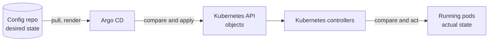

# 4. GitOps and Argo CD

*Monday, 15:30.*

"Kubernetes stores desired state," Sam says. "The question GitOps answers is: who writes that desired state, and where does the real copy live?"

## From YAML files to a config repo

The Deployment in the last chapter is a YAML file. Reconcile has a few of those: a Deployment and a Service for the backend, the same for the frontend, a ConfigMap for settings. Most of the content is the same between dev and prod; a few values differ (image tag, replica count, hostnames).

Rather than copying files per environment, the team uses **Helm**, a templating tool for Kubernetes manifests. A Helm **chart** is a folder of templates plus default values; per-environment **values files** fill in the differences:

```
reconcile/                          ← the config repo
└── charts/reconcile/
    ├── Chart.yaml
    ├── templates/
    │   ├── backend-deployment.yaml
    │   └── frontend-deployment.yaml
    ├── values.yaml                 ← defaults
    ├── values-dev.yaml             ← dev overrides
    └── values-prod.yaml            ← prod overrides
```

The template has placeholders:

```yaml
# templates/backend-deployment.yaml (excerpt)
spec:
  replicas: {{ .Values.backend.replicaCount }}
  template:
    spec:
      containers:
        - name: backend
          image: "{{ .Values.backend.image.repository }}:{{ .Values.backend.image.tag }}"
```

And the dev values file fills them in:

```yaml
# values-dev.yaml
backend:
  image:
    repository: registry.example.com/reconcile-backend
    tag: a1b2c3d          # managed by deployctl
  replicaCount: 3         # managed by deployctl
frontend:
  image:
    repository: registry.example.com/reconcile-frontend
    tag: a1b2c3d
  replicaCount: 1
```

Rendering the chart with `values-dev.yaml` produces the exact Deployment from chapter 3. Changing `backend.image.tag` in this file **is** the deploy; everything else follows from it.

This repository is the **config repo**. It is separate from the app's source repo: source code lives in one place, the description of what runs where lives in another.

> **Aside: if Git is new to you.** A Git repository is a folder with a full history of changes. Each saved change is a **commit** with an author, a message and a unique hash. A **branch** (like `main`) is a named pointer to the latest commit in a line of history. **Pushing** sends your commits to the shared copy (here, on GitHub). If someone else pushed first, your push is rejected until you fetch their commits and put yours on top. That rejection will matter on Wednesday.

## GitOps in four rules

**GitOps** is a way of running systems where:

1. **The desired state is declarative.** You describe *what* should exist (YAML), not *how* to make it so (commands).
2. **It is stored in Git.** Git is the single source of truth, versioned and reviewable, with history.
3. **It is pulled, not pushed.** An agent next to the cluster pulls changes from Git. Nobody pushes changes into the cluster.
4. **It is continuously reconciled.** The agent keeps comparing the cluster to Git and corrects any difference.

Rule 4 should sound familiar: it is the reconciliation loop from chapter 3, one level up. Kubernetes controllers make the cluster match its stored objects; a GitOps agent makes the stored objects match Git.



Two loops, stacked. Change the top, and the change flows down.

## Argo CD

**Argo CD** is the GitOps agent the team uses. It runs inside the cluster, in the `gitops` namespace. For each environment of each app there is an Argo CD **Application**, an object that says "render this path of this repo at this branch, and make that namespace match":

```yaml
apiVersion: argoproj.io/v1alpha1
kind: Application
metadata:
  name: reconcile-dev
  namespace: gitops
spec:
  source:
    repoURL: https://github.com/example/reconcile.git
    targetRevision: main
    path: charts/reconcile
    helm:
      valueFiles: [values.yaml, values-dev.yaml]
  destination:
    server: https://kubernetes.default.svc
    namespace: demo-dev
  syncPolicy:
    automated:
      prune: true
      selfHeal: true
```

For each Application, Argo CD reports two things:

**Sync status**: does the cluster match Git?

| Status | Meaning |
|---|---|
| `Synced` | Every rendered object matches what is in the cluster |
| `OutOfSync` | Something differs (Git changed, or someone changed the cluster) |
| `Unknown` | Argo CD could not compare (for example, the repo was unreachable) |

Argo CD also reports **which commit** it last compared the cluster against, the
**sync revision**. Seeing a new revision does not mean it has been applied yet:
the application may still be `OutOfSync`. deployctl checks revision, sync status,
health and pods together.

**Health**: are the objects working?

| Status | Meaning |
|---|---|
| `Healthy` | All resources are fine (for a Deployment: rollout complete, all replicas available) |
| `Progressing` | Still getting there (rollout in progress) |
| `Degraded` | Failed (for example, a rollout exceeded its progress deadline) |
| `Missing` | Objects in Git do not exist in the cluster |

Sync and health are independent. An app can be `Synced` and `Degraded`: the cluster matches Git exactly, and what Git describes is broken. That is what a bad deploy looks like.

### How fast does Argo CD notice a change?

By default, Argo CD checks the repo every **three minutes**. You can also ask it to look right now: a **refresh**. With `syncPolicy.automated`, once it sees the new commit it applies it (a **sync**) without anyone clicking a button.

deployctl's `argocd_refresh` step exists purely to skip the up-to-three-minute wait.

### Self-healing and drift

`selfHeal: true` means: if the cluster drifts from Git (someone changes it by hand), put it back. **Drift** is any difference between Git and the cluster that Git did not cause.

Linh connects the dots. "So on the Friday, Alex changed the Deployment directly. Argo CD saw `OutOfSync`, and because of `selfHeal`, it re-applied what Git said, which was the old tag. Every three minutes."

"Exactly. Argo CD was right; Alex's change was drift. The fix wasn't to turn off self-healing. It was to make sure nobody changes the cluster by any other path."

## What "deploy" and "rollback" mean under GitOps

Under GitOps:

- **Deploy** = commit a new image tag to the config repo.
- **Scale** = commit a new replica count.
- **Rollback** = commit the *previous* image tag. It is a new commit going forward, not deleting or rewriting history. History stays an honest record of what was running when.

And the team's rule, which deployctl enforces by design:

> **Git is the only write path.** Nothing changes the cluster except Argo CD applying Git.

That is why deployctl itself holds **no** credentials that can change the cluster. It can only commit to the config repo. It can read the cluster to see how things are going, but it cannot touch it.

## So why not just edit the file?

Linh asks the obvious question. "If deploying is just editing one line in `values-dev.yaml`, why do I need deployctl? I could do it in the GitHub web editor."

Sam counts on their fingers.

1. "You'd need write access to the repo that controls production. So would every developer. That's the laptop problem again, just with GitHub instead of kubectl."
2. "Nothing would stop you editing `values-prod.yaml` alone at 7 p.m. on a Friday."
3. "Two people editing the same file at the same time is how we lost twenty minutes on that Friday."
4. "After you commit, how do you know it worked? You'd open Argo CD, wait, refresh, look at pods. Every time."
5. "And when it breaks, you'd go hunting for the previous tag in Git history."

"deployctl does those five things for you, and it's the only thing with write access to that repo. You get to deploy without being able to break the rules."

"Tomorrow I'll show you how deployctl knows it's you."

---

## Check yourself

<details>
<summary>1. What are the four GitOps rules?</summary>

Declarative desired state; stored in Git as the single source of truth; pulled by an agent near the cluster rather than pushed into it; continuously reconciled.
</details>

<details>
<summary>2. An app is <code>Synced</code> and <code>Degraded</code>. What does that tell you?</summary>

The cluster matches Git exactly, but what Git describes is not working. Typically: a bad image tag was committed and the new pods are crashing or cannot start. The fix is a new commit (a fix or a rollback), not a sync.
</details>

<details>
<summary>3. Right after deployctl pushes a commit, Argo CD shows <code>Synced</code> and <code>Healthy</code>. Is the deploy done?</summary>

Not necessarily. Argo CD may not have seen the new commit yet, so `Synced` could refer to the previous commit. That is why deployctl also checks that Argo CD's sync revision is the commit it pushed (or a later one that still deploys the new tag), and that the pods run the new tag.
</details>

<details>
<summary>4. Why is a rollback a new commit instead of a <code>git revert</code> or resetting the branch?</summary>

A new commit keeps history honest and linear: every state the environment was in is visible, in order. Resetting rewrites history that others (and Argo CD) have already seen. A `git revert` would also be a forward commit, but it undoes a specific commit's whole diff, which might include unrelated changes; setting the tag to a known good value is precise.
</details>

Next: [5. Who are you? Identity](05-identity.md)
