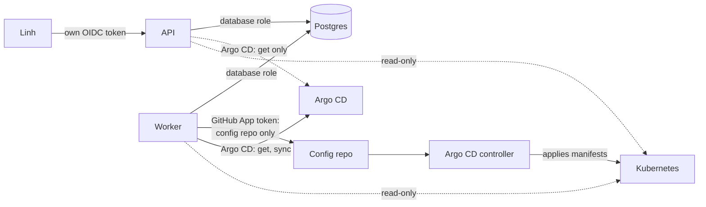

# 6. What may you do? Access and least privilege

*Tuesday, 10:00.*

"Knowing who you are is half of it," Sam says. "Now: what may you do? And, just as important, what may each part of deployctl do?"

## Roles

deployctl has four **roles**. Each includes everything the one above it can do:

| Role | Can | Who has it on the Reconcile team |
|---|---|---|
| `viewer` | See apps, status and requests | Support staff, product managers |
| `developer` | Deploy, scale and roll back non-production; *request* production changes; retry or cancel their own requests | Linh, the other developers |
| `approver` | Approve or reject production requests; read the audit log | Priya, Sam |
| `admin` | Retry or cancel anyone's request | Sam |

This is **role-based access control** (**RBAC**): permissions are attached to roles, and people get roles (here, through group membership). You never grant a permission to an individual directly, which keeps the system understandable: "who can approve production?" is answered by looking at one group.

Notice what is **not** in the table: nobody, not even an admin, can change the cluster directly through deployctl, and nobody can push to the config repo through deployctl except via a request.

### One function decides

Every decision goes through one function in the code, `Policy.Authorize(who, action, app, env)`. It is deliberately boring:

```go
switch action {
case ActionDeployNonProd:     // deploy, scale, rollback where requiresApproval is false
    return allowIf(who.Has(RoleDeveloper))
case ActionRequestProd:       // ask for a change where requiresApproval is true
    return allowIf(who.Has(RoleDeveloper))
case ActionApprovalDecide:
    return allowIf(who.Has(RoleApprover))
...
}
```

Keeping authorization in one place means it can be tested with one table that lists every role against every action, and a reviewer can read the whole policy in two minutes. Security rules scattered across handlers are the ones that end up with gaps.

What makes an environment "production" is not its name, but a setting: `requiresApproval: true`. The code never checks `if env == "prod"`. A new environment called `production-eu` cannot accidentally skip approval because someone forgot to add its name to a list.

## Approvals: the two-person rule

A developer can *request* a production change, but it does not happen until someone with the `approver` role approves it. This is **separation of duties**, also called the **four-eyes principle**: no single person can make a production change alone.

Why does it help? Not because developers are untrustworthy, but because:

- people under pressure skip steps (the Friday incident),
- a second person catches the "wrong tag" or "wrong environment" mistake,
- a stolen identity is not enough to change production.

The rule has one important detail: **nobody can approve their own request**. Not even an admin. Sam is an admin, and if Sam requests a production deploy, Priya has to approve it.

That rule is enforced twice. The policy code checks it and returns a clear error. And the database itself has a constraint:

```sql
CHECK (decided_by <> requested_by)
```

so even a bug in some future version of the code cannot store a self-approval. A recurring idea in deployctl: **if breaking a rule would be a security bug, the database enforces it, not just the code.**

"Guardrails, not gates," Sam says. "Dev is a playground. Nobody has to ask permission to deploy there. Production gets exactly one extra step: a second person."

## Least privilege, for software too

**Least privilege** means: every person *and every program* gets the minimum access needed for its job, and no more. People usually apply it to humans and forget the software. deployctl applies it to each of its own parts.

deployctl runs as three pieces:

- the **API**, which talks to the CLI over the network,
- the **worker**, which actually does the work (commits to Git, talks to Argo CD),
- **Postgres**, the database where requests are recorded.

Chapter 7 explains why they are split. For now, look at what each one holds:



Dashed arrows are read-only.

| Who | Holds | Cannot |
|---|---|---|
| Linh | Their own login token | Touch Git, Argo CD or the cluster |
| API | Database access; read-only Argo CD and Kubernetes | Push to Git; sync Argo CD; change the cluster |
| Worker | Database access; a GitHub token for **one** repo; Argo CD refresh and sync for managed apps; read-only Kubernetes | Change the cluster; push to any other repo |
| Argo CD | Cluster write access | (not used by deployctl) |

Only one thing in the whole system can write to the cluster: Argo CD, and only by applying Git. Only one thing can write to Git on deployctl's behalf: the worker, and only to the config repo.

### Why the worker uses a GitHub App, not a personal token

The easiest way to let a program push to GitHub is to create a **personal access token** from someone's account and paste it in. It is also the worst:

- it is tied to a person; when they leave, deploys break,
- it usually can access every repo that person can access,
- it often never expires.

Instead, deployctl uses a **GitHub App**: a non-human identity, installed on **only** the config repo, with permission to **read and write file contents** and nothing else. The worker holds the App's private key and uses it to get an **installation token** that expires after one hour. If a token leaks, it is useless within the hour, and it can only touch one repo.

### Read-only means read-only

The worker and API can *read* pods, events and logs in the app namespaces, because they need to report health. They cannot create, change or delete anything, and they cannot read Kubernetes Secrets. The permission is written out explicitly:

```yaml
rules:
  - apiGroups: [""]
    resources: ["pods", "events"]
    verbs: ["get", "list", "watch"]
  - apiGroups: [""]
    resources: ["pods/log"]
    verbs: ["get"]
```

No `create`, no `update`, no `delete`, no `secrets`.

## Blast radius: a thought experiment

Sam draws a box around the API. "Suppose an attacker finds a bug and gets to run code inside the API. What can they do?"

Linh works through the table:

- **Change the cluster?** No. The API has no cluster write access.
- **Push to Git?** No. The API has no GitHub credential. It isn't even in the API's environment, and the code that pushes to Git isn't allowed to be imported by the API package.
- **Read secrets?** Not Kubernetes Secrets; the read-only role excludes them.
- **Write to the database?** Yes. That is the API's job.

"So they could insert a fake deploy request, and the worker would carry it out?"

"Right. That's the residual risk, and the security doc says so honestly. The worker would still only edit the configured key in the configured file, and would only deploy an image tag, not arbitrary YAML. For production, they'd also have to fake an approval row, which is in the same database. We've accepted that for now and written it down."

This way of thinking is called **blast radius**: assume each part will be compromised someday, and ask how far the damage spreads. Least privilege is what keeps the radius small. The **threat model** in [security.md](../reference/security.md#threat-model) does this for every part of the system.

## The audit log

The last piece is accountability. Every action produces an **audit event**: who, what, when, to which app and environment, and the outcome.

```
AT                    ACTOR   ACTION              RESOURCE       OUTCOME
2026-11-19 10:14:30   Priya   approval.approved   backend/prod   success
2026-11-19 10:00:00   Linh    request.created     backend/prod   success
```

Two properties make it trustworthy:

1. **Written in the same transaction as the change.** If the change is saved, the audit event is saved; if one fails, both do. The log cannot miss an action or record one that did not happen.
2. **Append-only.** The database role deployctl uses can insert and read audit events, but not update or delete them, and a database trigger refuses updates and deletes from anyone. Not even a bug in deployctl can rewrite history.

There is a second, independent trail too: every commit deployctl makes says who requested it and who approved it, right in the Git history.

"You've now got all the background," Sam says. "Let's deploy your fix."

---

## Check yourself

<details>
<summary>1. Sam is an admin. Can Sam approve Sam's own production request? Why is the rule enforced in the database as well as in code?</summary>

No. Nobody can approve their own request, including admins. The database constraint means that even a future code bug or a new endpoint that forgets the check cannot store a self-approval.
</details>

<details>
<summary>2. Why is "production" defined by <code>requiresApproval: true</code> and not by the environment name?</summary>

Name matching is fragile: a new environment with a slightly different name (`production-eu`, `prd`) would silently skip approval. A setting on the environment cannot be misspelled into a bypass.
</details>

<details>
<summary>3. List three reasons the worker uses a GitHub App rather than a personal access token.</summary>

It is not tied to a person (nothing breaks when someone leaves); it is installed on one repo with one permission; the token it uses expires within an hour. Also, branch protection can name the App specifically in its bypass list.
</details>

<details>
<summary>4. Why does deployctl split the API (talks to users) from the worker (writes to Git)?</summary>

So that the part exposed to the network holds no write credentials. If the API is compromised, the attacker cannot push to Git or change the cluster directly. Only the worker, which takes no requests from users, can push.
</details>

Next: [7. The first deploy, step by step](07-first-deploy.md)
