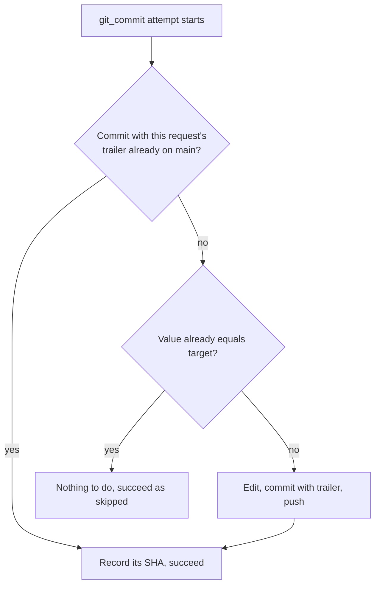

# 8. When things break

*Wednesday.*

Tuesday went smoothly. Sam says that's the least interesting kind of day. "Any tool works when nothing goes wrong. What matters is what happens when the network drops, a machine dies, or the code is broken. Today you'll see all three."

Most of what makes deployctl reliable comes from two ideas you've already seen:

- **Durable intent first:** every step is written down before and after it runs.
- **Idempotency:** doing something twice has the same effect as doing it once.

Today shows why each one is there.

## 08:50. The train Wi-Fi drops

Linh is on the train, and a colleague asks for the rounding fix in the frontend too. Linh runs:

```bash
$ deployctl deploy frontend --env dev --tag e4f5a6b
```

The train enters a tunnel. The request leaves the laptop, but the response never arrives. Did it work?

The CLI does not know, so it retries, automatically, a second later, **with the same `Idempotency-Key`**. The API looks up the key, sees it has already handled that exact request from Linh, and returns the stored response: the same request ID. One request, not two.

Out of habit, Linh also presses ↑ and Enter to run the command again by hand. This time the CLI generates a **new** key, because it's a new command. The API tries to insert a second request for `frontend`/`dev` and the database's one-active-request rule refuses:

```
✖ Another request is active for frontend/dev: 7a21 (running)
  Follow it:  deployctl request 7a21 --watch
```

Exit code `5`. Linh follows the existing one instead.

So there are two different guards against doing it twice:

| Situation | Guard | Result |
|---|---|---|
| Same command, retried by the client | Idempotency key | Same response, nothing new created |
| A genuinely new request while one is in flight | One active request per app and environment | `409 Conflict` pointing at the existing one |

An **idempotent** operation is one you can safely repeat. "Set the tag to `e4f5a6b`" is idempotent; "add one replica" is not. The idempotency key makes a non-idempotent HTTP `POST` behave idempotently from the client's point of view.

## 10:05. A worker dies mid-step

Sam is upgrading the cluster's nodes, which means draining them one at a time: pods on that node are stopped and recreated elsewhere. One of deployctl's worker pods is on the node being drained. It is killed while running a step.

Which step matters a lot. Linh and Sam look at two versions of the story.

### Version 1: the worker dies *before* pushing

The worker had claimed `git_commit` for a request, edited the file in its local clone, and died before `git push`.

- Nothing was pushed. GitHub has no new commit.
- The step's row in Postgres still says `running`, owned by the dead worker, with a lease ending in a few seconds.
- The lease expires. Nobody renewed it.
- The other worker's claim query also looks for `running` steps whose lease has expired, and claims this one. Attempt 2.
- Attempt 2 searches Git history for the request's trailer: not found. Reads the current tag: still the old one. Edits, commits, pushes. Done.

The only effect of the crash was a delay of about 30 seconds.

### Version 2: the worker dies *after* pushing, before recording it

This is the nasty one. The push succeeded. GitHub has commit `5e6f7a8` with `Deployctl-Request: 41c9...` in its message. But the worker died before it could write "git_commit succeeded, sha 5e6f7a8" to the database. As far as Postgres knows, the step is still running.

- The lease expires; the other worker claims the step. Attempt 2.
- Attempt 2's **first** action is the trailer search: look through recent commits on `main` for `Deployctl-Request: 41c9...`.
- **Found:** `5e6f7a8`. The work is already done. Record the SHA, mark the step succeeded, carry on to `argocd_refresh`.

Without the trailer search, attempt 2 would compare the current tag with the target, find them equal (because the push worked), and skip the edit. That would also be fine, but the worker wouldn't know *which* commit to wait for in `wait_healthy`. And if someone else had changed the tag in between, it couldn't tell "my change" from "someone else's". The trailer gives an exact answer.



This is what "every step is idempotent" means in practice: each step **checks before it acts**, so running it again after a crash converges on the same result instead of doing the work twice.

### The zombie worker

Sam adds a twist. "What if the worker didn't die, but froze? A long garbage-collection pause, or the node's network hiccuped for a minute. Its lease expires, another worker takes over and finishes the step. Then the first one wakes up and tries to write 'succeeded' with its old result."

The answer is **fencing**. Every write a worker makes about a step includes "...where the owner is still me and the attempt number is still mine":

```sql
UPDATE steps SET status = 'succeeded', ...
WHERE id = $step AND claimed_by = 'worker-a' AND attempt = 1;
```

The zombie's update matches zero rows, because the step now belongs to attempt 2. The zombie sees that, throws its result away and moves on. Its heartbeat would have discovered the same thing.

Fencing protects the database. It can't stop a zombie that has already sent a push to GitHub, which is why `git_commit` also needs to be idempotent on its own. The two ideas cover each other.

## 11:30. Two pushes at once

Linh deploys `backend` to dev. At the same second, a colleague deploys `frontend` to dev. Different apps, so both requests are allowed. But both change files in the same config repo, on the same branch.

Both workers fetch `main` at commit `aaa`. Both commit on top of it. The colleague's push lands first; `main` is now `bbb`. Linh's push is rejected by GitHub as **non-fast-forward**: "your commit is based on `aaa`, but `main` has moved on."

The worker handles it the way a careful human would: fetch `main` again (now `bbb`), re-apply its one-line edit on top of the new version, commit, push. It allows up to five rounds of this before treating it as a temporary error and backing off.

This is safe for the same reason the Friday incident wasn't: deployctl re-applies **its own edit** to the **latest** file. It never resolves a conflict by keeping an old copy of the whole file. And because only one request per app and environment is active at once, two edits to the *same* key never race.

## 14:00. A bad deploy

After lunch, Linh ships a second change: rounding mode should be configurable. CI builds `f00ba47`. Linh deploys it to dev.

```
✔ Request 2d4f created
✔ validate        e4f5a6b → f00ba47
✔ git_commit      pushed 8a9b0c1
✔ argocd_refresh
⏳ wait_healthy    0/4 pods ready on f00ba47
✖ wait_healthy    pod reconcile-backend-7d9f8c-x2kq restarted 3 times

  Events (reconcile-backend-7d9f8c-x2kq):
    Warning  BackOff   Back-off restarting failed container backend
  Logs (reconcile-backend-7d9f8c-x2kq, previous):
    panic: missing env INVOICE_ROUNDING_MODE

✖ Request 2d4f failed. The new tag is still in Git.
  Roll back:  deployctl rollback backend --env dev
  Retry:      deployctl retry 2d4f
```

The new code requires an environment variable that the Helm chart doesn't set yet. Every new pod starts, panics and exits: `CrashLoopBackOff` from chapter 3. `wait_healthy` notices three restarts and fails early rather than waiting the full five minutes. It also fetched the pod's events and the last log lines of the crashed container and put them in front of Linh, who has no cluster access and doesn't need it.

**What are users seeing right now?** Linh's heart rate goes up, but the answer is: nothing much. The rolling update never got a new pod to *ready*, so Kubernetes never removed the old ones. Dev is still serving `e4f5a6b`. That's the safety net of readiness probes and rolling updates.

**But Git now says `f00ba47`.** Argo CD will keep trying to make the cluster match it.

### Why deployctl didn't roll back by itself

"Shouldn't it just undo it automatically?" Linh asks.

Sam has clearly had this argument before. "A deploy failing health checks has lots of possible causes. Broken code, sure. But also: the cluster is out of memory, the database the app depends on is down, the timeout is too short for a slow startup. In half of those, rolling back does nothing or makes it worse. And an automatic rollback in production is a second change nobody approved, happening right when people are trying to understand the first one."

So deployctl's rule is: **fail clearly, give the diagnostics, let a human decide.** The failure message prints both options.

### Retry or roll back?

- **Retry** resumes from the failed step: it would just watch the same crashing pods again. Retry is for *temporary* failures, like GitHub being down.
- **Fix forward:** add the environment variable to the chart (that's a change to the chart templates, done by pull request, not through deployctl), then deploy again.
- **Roll back:** put the previous good tag back.

The fix will take a while, so Linh rolls back. First, a dry run to see what it would do:

```bash
$ deployctl rollback backend --env dev --dry-run
Would roll back backend/dev: f00ba47 → e4f5a6b
  e4f5a6b was deployed successfully by Linh Tran at 2026-11-17 11:00 (request 0b8e)
```

How did it pick `e4f5a6b`? Rollback chooses the **most recent successful deployment whose tag differs from what Git says now**. Git says `f00ba47`. `f00ba47` never succeeded, so it isn't in the deployment history at all; the most recent entry is `e4f5a6b`. (If `f00ba47` *had* passed health checks and turned out to be subtly wrong later, it would be the newest entry, and "differs from what Git says" would skip it and pick the one before.)

```bash
$ deployctl rollback backend --env dev
✔ Request 5c3e created
✔ validate        f00ba47 → e4f5a6b
✔ git_commit      pushed 9d8c7b6
✔ argocd_refresh
✔ wait_healthy    3/3 pods ready on e4f5a6b
✔ Rolled back in 21s
```

A rollback is just another request with another commit, `rollback(backend/dev): f00ba47 -> e4f5a6b`. History now shows both the bad deploy and its reversal, in order. Nothing was rewritten.

## 16:20. GitHub has an outage

Late in the day, GitHub has a partial outage. A teammate's deploy hits it:

```
⏳ git_commit      GitHub returned 503, retrying in 4s (attempt 2/5)
⏳ git_commit      GitHub returned 503, retrying in 8s (attempt 3/5)
```

The worker classifies every error as either **retryable** (network errors, timeouts, 5xx responses, being rate-limited) or **permanent** (wrong file path, branch protection blocking the push, a revoked credential). Retryable errors put the step back in the queue with a growing delay, called **exponential backoff**, so a struggling service isn't hammered. After five attempts the request fails, with the last error recorded.

Half an hour later GitHub is back. The teammate runs `deployctl retry 6e1a`, which resumes from `git_commit`, not from the beginning. The trailer search runs first, as always, just in case.

## The day in one table

| What went wrong | What protected Linh | Where it's specified |
|---|---|---|
| Client retried after a dropped connection | Idempotency key | [request-lifecycle.md#idempotency](../reference/request-lifecycle.md#idempotency) |
| Second request for the same app/env | One-active-request index → `409` | [ADR 0007](../adr/0007-one-active-request-per-app-and-environment.md) |
| Worker died before pushing | Lease expiry + reclaim; durable step state | [request-lifecycle.md#leases-heartbeats-and-fencing](../reference/request-lifecycle.md#leases-heartbeats-and-fencing) |
| Worker died after pushing | Commit trailer search | [ADR 0008](../adr/0008-idempotency-at-api-and-step-level.md) |
| Frozen worker woke up late | Fencing on `claimed_by` and `attempt` | [ADR 0003](../adr/0003-postgres-as-the-job-queue.md) |
| Two pushes to the same branch | Re-fetch and re-apply own edit | [request-lifecycle.md#git_commit](../reference/request-lifecycle.md#git_commit) |
| Broken code | Readiness + rolling update kept old pods; diagnostics; explicit rollback | [ADR 0009](../adr/0009-no-automatic-rollback.md) |
| GitHub outage | Retryable errors with backoff; manual retry from the failed step | [request-lifecycle.md#automatic-step-retries](../reference/request-lifecycle.md#automatic-step-retries) |

---

## Check yourself

<details>
<summary>1. What's the difference between what the idempotency key prevents and what the one-active-request rule prevents?</summary>

The idempotency key makes a *retry of the same client request* return the original result instead of creating a duplicate. The one-active-request rule refuses a *new, different* request for an app and environment that already has one in flight.
</details>

<details>
<summary>2. A worker crashes after pushing but before updating the database. Walk through what happens next.</summary>

The step stays `running` with an expiring lease. When the lease expires, another worker reclaims it (attempt 2). Attempt 2 first searches recent commits for the request's `Deployctl-Request` trailer, finds the commit, records its SHA and marks the step succeeded, without pushing again. The pipeline continues with `argocd_refresh`.
</details>

<details>
<summary>3. Why doesn't fencing alone make <code>git_commit</code> safe?</summary>

Fencing only stops a stale worker from writing to the database. A stale worker could still have pushed to GitHub before realising it lost its lease. The step itself must be idempotent (trailer search, comparing current to target) to handle that.
</details>

<details>
<summary>4. Git says <code>f00ba47</code> (failed). Deployment history is: <code>e4f5a6b</code> (yesterday), <code>a1b2c3d</code> (last week). What does rollback choose? What if history were <code>f00ba47</code>, <code>e4f5a6b</code>, ...?</summary>

In the first case, `e4f5a6b`: the most recent successful tag that differs from Git. In the second case (where `f00ba47` passed health checks and was recorded), it skips `f00ba47` because it equals what Git says, and again picks `e4f5a6b`.
</details>

<details>
<summary>5. When should you use <code>retry</code> and when <code>rollback</code>?</summary>

`retry` is for temporary failures in the outside world (GitHub or Argo CD unavailable): the same step will probably succeed next time. `rollback` (or a fix-forward deploy) is for when the change itself is bad; retrying would just watch it fail again.
</details>

Next: [9. Going to production](09-production.md)
