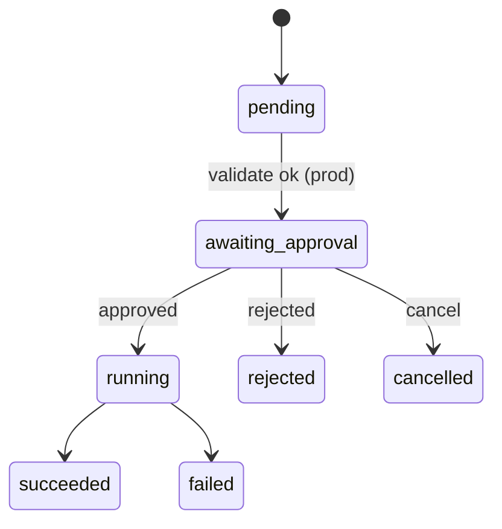

# 9. Going to production

*Thursday and Friday.*

The rounding fix (`e4f5a6b`) has been in dev for two days. QA is happy. It's time for production, where customers are, and where the rules change.

## Thursday 10:00. Linh requests a production deploy

```bash
$ deployctl deploy backend --env prod --tag e4f5a6b --reason "Fix rounding in invoice totals"
✔ Request 4a7c created
✔ validate        9f8e7d6 → e4f5a6b
⏸ approval_gate   waiting for approval: 9f8e7d6 → e4f5a6b
                  approvers: Priya, Sam (deployctl-approvers)
                  ask them to run: deployctl approve 4a7c
```

Same command, one new line. Here's what's different.

**The authorization check.** `prod` has `requiresApproval: true`, so the action is `deploy:prod:request`, not `deploy:nonprod`. Developers are allowed to *request*, not to *deploy*.

**The steps.** The API created six steps instead of five, with an `approval_gate` between `validate` and `git_commit`:

```
validate → approval_gate → git_commit → argocd_refresh → wait_healthy → finalize
```

**The gate.** When a worker reaches `approval_gate`, it creates an approval record, marks the step `waiting` and the request `awaiting_approval`, then **lets go**. No worker sits waiting for a human; the request is just a row that will wait as long as it takes.



Notice that validation happened *before* the gate. The approver will see a concrete change, `9f8e7d6 → e4f5a6b`, plus any warnings, and doesn't have to work out what "deploy e4f5a6b" means for themselves.

Linh presses Ctrl-C to get their terminal back. That **detaches**; it doesn't cancel. The request carries on without the CLI.

## 10:02. Linh tries a shortcut

Linh is curious. They don't have the approver role, but what if they did? Sam, who is an admin and an approver, demonstrates on a test request of their own:

```bash
$ deployctl approve 3f1d
✖ You cannot approve your own request (requested by Sam).
```

`403`, problem type `self-approval`. Sam has every role there is, and it makes no difference. As chapter 6 explained, this is checked in the code *and* enforced by a constraint in the database. Sam cancels the test request:

```bash
$ deployctl cancel 3f1d
✔ Request 3f1d cancelled
```

Cancel works because `3f1d` hasn't reached `git_commit`. Before that point nothing outside deployctl has changed, so cancelling is clean. After it, the change is in Git, and the only way back is a rollback.

## 10:14. Priya reviews

Priya sees the request in their list:

```bash
$ deployctl approvals
ID     APP      ENV   CHANGE                  REQUESTED BY   AGE   WARNINGS
4a7c   backend  prod  deploy 9f8e7d6→e4f5a6b  Linh Tran      14m
```

Priya checks three things: that `e4f5a6b` is the commit that was tested in dev (`deployctl status backend` shows dev running it, healthy, for two days), what changed between `9f8e7d6` and `e4f5a6b` in the source repo, and that there are no warnings. Then:

```bash
$ deployctl approve 4a7c --comment "Tested in dev since Tuesday, diff reviewed"
✔ Approved. Request 4a7c is running.
```

In one database transaction, the API:

- marks the approval `approved`, with Priya as the decider and the comment,
- marks `approval_gate` succeeded and `git_commit` ready,
- moves the request to `running`,
- writes the audit event,
- notifies.

From here it's Tuesday's pipeline. Linh reattaches to watch:

```bash
$ deployctl request 4a7c --watch
✔ validate        9f8e7d6 → e4f5a6b
✔ approval_gate   approved by Priya
✔ git_commit      pushed 6d5e4f3
✔ argocd_refresh
✔ wait_healthy    5/5 pods ready on e4f5a6b
✔ Deployed in 49s (approval wait 14m)
```

The commit in the config repo now has both people in it:

```
deploy(backend/prod): 9f8e7d6 -> e4f5a6b

Requested-by: linh@example.com
Approved-by: priya@example.com

Deployctl-Request: 4a7c9e10-2b3d-4f5a-8c6e-1d2f3a4b5c6d
```

## A note on what approval does and doesn't check

Linh asks: "What if Priya had approved a week later, and in the meantime someone else had deployed something newer to prod?"

"Two things protect you there," Sam says. "First, while your request is waiting, it's the one active request for `backend`/`prod`, so nobody *can* deploy anything else to it. They'd get a `409` pointing at your request. They'd have to ask you to cancel it first. Second, `git_commit` always reads the current value fresh before editing, so it never works from stale data."

"But it's true that an approval doesn't expire. A week-old approval would still ship. That's listed as an open question in the design. We'll probably add a time limit."

The design docs are honest about gaps like this. It's worth reading the "Open questions" and "Known gaps" sections in the reference docs. They tell you where the edges are.

## Friday 15:40. A production rollback

On Friday afternoon, Priya ships a different change to production: `c0ffee1`, a new matching algorithm. It passes health checks. Pods are ready, and Argo CD says `Healthy`. Twenty minutes later, the support channel lights up: some payments are being matched to the wrong invoices.

Health checks can't catch this. The pods are running fine; the *logic* is wrong. This is exactly the kind of failure no automatic system would have rolled back.

Priya, the requester of the bad change, starts the rollback:

```bash
$ deployctl rollback backend --env prod --dry-run
Would roll back backend/prod: c0ffee1 → e4f5a6b
  e4f5a6b was deployed successfully by Linh Tran (request 4a7c)

$ deployctl rollback backend --env prod --reason "Wrong invoice matches after c0ffee1"
✔ Request 8b2a created
✔ validate        c0ffee1 → e4f5a6b
⏸ approval_gate   waiting for approval: c0ffee1 → e4f5a6b
```

This time the history has `c0ffee1` as its newest entry, because it *did* pass health checks. Rollback skips it because it equals what Git currently says, and picks `e4f5a6b`.

A production rollback is still a production change, so it still needs a second person. Priya pings the team. Linh doesn't have the approver role. Sam does:

```bash
$ deployctl approve 8b2a --comment "Confirmed wrong matches in support tickets"
```

Twenty minutes after the first support ticket, production is back on `e4f5a6b`. Most of that time was spent confirming the problem; the rollback itself, approval included, took about three minutes.

"Doesn't the approval slow down incidents?" Linh asks.

"By a couple of minutes, if an approver is around," Sam says. "That's the price of the two-person rule. Compare it with the Friday last year: two hours, because nobody knew what was running or why it kept changing. Today everyone could see exactly what was deployed, by whom, and what the last good version was. The roadmap has an idea for an audited break-glass rollback, but we'd rather have a reachable approver."

## The audit trail

On Monday, the team holds a short review of Friday's issue. Priya pulls the record:

```bash
$ deployctl audit --app backend --env prod --since 4d
AT                    ACTOR    ACTION              DETAIL
2026-11-20 16:01:12   system   request.succeeded   rollback c0ffee1 → e4f5a6b (8b2a)
2026-11-20 15:59:30   system   git.committed       9e8d7c6 (8b2a)
2026-11-20 15:59:28   Sam      approval.approved   8b2a "Confirmed wrong matches..."
2026-11-20 15:58:10   Priya    request.created     rollback (8b2a) "Wrong invoice matches after c0ffee1"
2026-11-20 15:20:44   system   request.succeeded   deploy e4f5a6b → c0ffee1 (77f0)
2026-11-20 15:19:01   Linh     approval.approved   77f0 "New matcher reviewed in PR #412"
2026-11-20 15:02:33   Priya    request.created     deploy c0ffee1 (77f0)
2026-11-19 10:15:20   system   request.succeeded   deploy 9f8e7d6 → e4f5a6b (4a7c)
2026-11-19 10:14:30   Priya    approval.approved   4a7c "Tested in dev since Tuesday..."
2026-11-19 10:00:00   Linh     request.created     deploy e4f5a6b (4a7c)
```

Wait: Linh approved Priya's `c0ffee1` deploy? Earlier in the week Linh had only the developer role. Priya explains that Linh was added to `deployctl-approvers` on Thursday afternoon after their first production deploy. Nothing in deployctl changed; the identity provider group did, and Linh's next token carried it. That too is visible: `deployctl whoami` shows the roles, and the group change is in the identity provider's own log.

Every line in that table was written in the same database transaction as the change it describes, by a database user that cannot edit or delete audit rows. And the config repo's history tells the same story independently, with the same request IDs in the trailers.

## The week in review

Back to Monday's list from the Friday incident. Here's what changed, and which part of the design did it:

| The problem last year | What happens now | The mechanism | Chapter |
|---|---|---|---|
| Too many people with full cluster access | Developers hold only a login. One component holds a narrow Git credential; nothing in deployctl can write to the cluster | Least privilege; GitHub App; read-only Kubernetes access | 5, 6 |
| Two write paths fighting (kubectl vs Git) | Git is the only write path; Argo CD self-heals any drift | GitOps; no cluster write credentials | 4 |
| No review of production changes | Production needs a second person, and you can't approve your own | `approval_gate`; database constraint | 6, 9 |
| Concurrent edits overwrote each other | One active request per app and environment; each edit re-applied to the latest file | Partial unique index; re-fetch and re-apply | 7, 8 |
| No record of who did what | Append-only audit log, plus trailers in every commit | Same-transaction audit events; Git trailers | 6, 9 |
| Rollback meant digging through history | `deployctl rollback` picks the last good tag | `deployments` history | 8, 9 |
| A crash mid-change left an unknown state | Work resumes from the last recorded step, without repeating side effects | Durable intent; leases; idempotent steps | 7, 8 |
| Stolen laptop meant rotating everything | A stolen laptop has a short-lived token for one person's role | OIDC; short tokens; keychain storage | 5 |

## Where to go from here

You now know enough to read the reference docs, which are written for people working *on* deployctl rather than *with* it:

- [Architecture](../reference/architecture.md): the components, the code layout and the interfaces between them.
- [Request lifecycle](../reference/request-lifecycle.md): the exact rules behind chapters 7 to 9, including every state and step.
- [Security](../reference/security.md): the full threat model, including the gaps.
- [Data model](../reference/data-model.md): the tables and the constraints that carry the design.
- [ADRs](../adr/): why each major decision was made, and what was rejected.

And the [glossary](glossary.md) has every term from this week in one place.

---

## Check yourself

<details>
<summary>1. A production request is <code>awaiting_approval</code>. How many workers are busy with it?</summary>

None. The worker that ran `approval_gate` created the approval, set the step to `waiting`, and released it. The approval decision (through the API) is what moves `git_commit` to `ready` so a worker can claim it.
</details>

<details>
<summary>2. Linh's prod request has been waiting an hour. Someone else needs to deploy an urgent fix to <code>backend</code>/<code>prod</code>. What happens, and what should they do?</summary>

Their request gets `409 Conflict` pointing at Linh's request, because only one request per app and environment can be active. Linh (or an admin) cancels the waiting request, which is allowed because it hasn't reached `git_commit`, and then the urgent request can be made.
</details>

<details>
<summary>3. Why couldn't health checks catch the <code>c0ffee1</code> problem, and what does that say about automatic rollback?</summary>

The pods were running and ready; the bug was in business logic, which readiness probes and Argo CD health don't measure. Automatic rollback based on health checks would not have triggered, and when health checks *do* fail, the cause is often not the code. A human with context makes the better call, with the tool making that call fast and safe.
</details>

<details>
<summary>4. Linh got the approver role on Thursday. What did someone change in deployctl to make that happen?</summary>

Nothing. Linh was added to the `deployctl-approvers` group in the identity provider. deployctl reads groups from the token on every request, so Linh's next token carried the new role.
</details>
