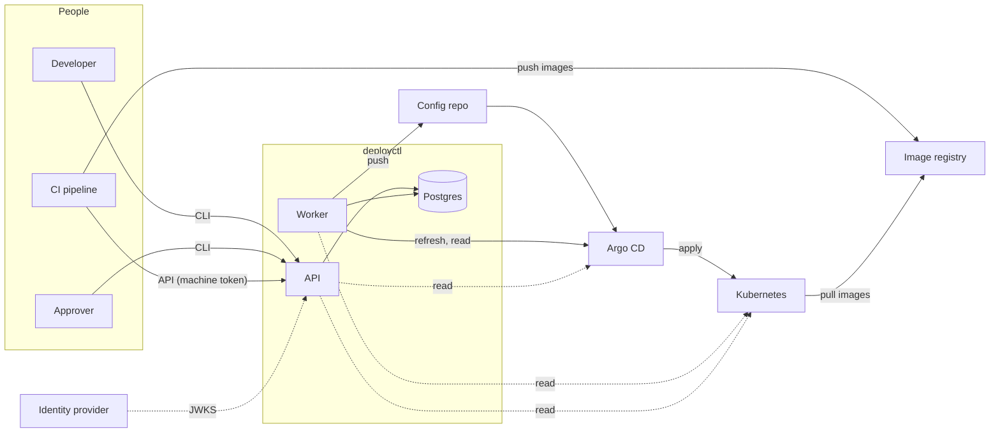
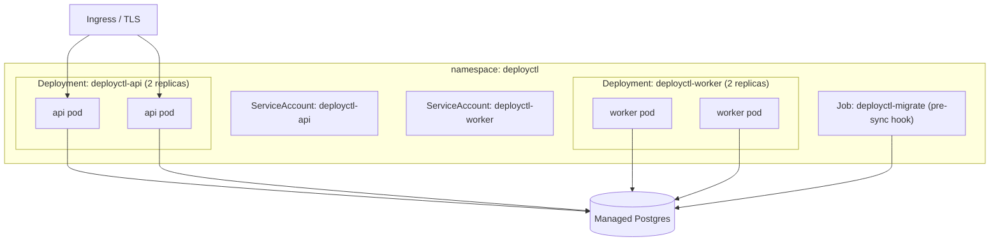
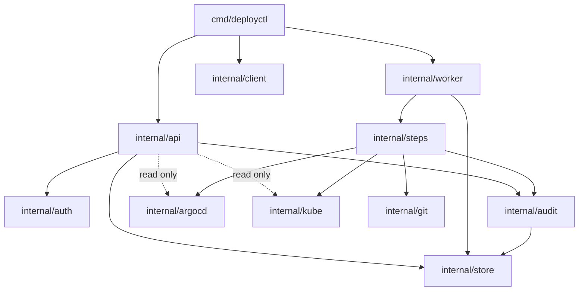

# Architecture

> **Status:** design. Nothing here is implemented yet. Where this document goes beyond the original README (lease timings, notification channel names, deployment topology), the detail is a proposal and is marked as such.

This document describes the components of deployctl, what each one is allowed to do, how they talk to each other, and how the code is organised. Read it first; the other reference documents assume you know the four boxes described here.

- [Context](#context)
- [Design principles](#design-principles)
- [Components](#components)
- [One binary, three modes](#one-binary-three-modes)
- [Communication paths](#communication-paths)
- [Runtime topology](#runtime-topology)
- [Code organisation](#code-organisation)
- [Key interfaces](#key-interfaces)
- [Scaling characteristics](#scaling-characteristics)
- [What is deliberately not here](#what-is-deliberately-not-here)

---

## Context

deployctl sits between developers and a GitOps setup that already exists:

- Applications are packaged as Helm charts (or plain manifests driven by values files) in a **config repo**.
- **Argo CD** watches that repo and applies whatever it says to one or more Kubernetes clusters.
- **CI** builds images and pushes them to a registry, tagged with something meaningful (usually the short Git SHA of the app's source).

Without deployctl, "deploying" means a human editing `image.tag` in a values file, committing to the config repo, and waiting for Argo CD. That works, but it gives everyone write access to the repo that controls production, offers no approval step beyond code review, gives no structured progress or audit trail, and makes rollback a matter of finding the right old SHA by hand.

deployctl turns those edits into **requests** that are authenticated, authorised, recorded, optionally approved, executed by a single trusted component, and observed until the rollout is healthy.



deployctl never talks to the registry (a tag-exists check is on the [roadmap](roadmap.md)) and never applies anything to Kubernetes itself.

## Design principles

| Principle | Consequence in the design | ADR |
|---|---|---|
| Git is the only write path | No component holds cluster write credentials. Rollback is a forward commit. | [0001](../adr/0001-git-is-the-only-write-path.md) |
| Durable intent first, side effects second | The API only writes rows and returns `202`. All external calls happen in the worker. | [0002](../adr/0002-persist-intent-before-side-effects.md) |
| Every step is idempotent | Steps compare current state to target before acting. Commits carry a request trailer. | [0008](../adr/0008-idempotency-at-api-and-step-level.md) |
| Least privilege | Users hold only their identity. The API holds nothing that writes. The worker writes only to the config repo. | [0006](../adr/0006-github-app-for-git-writes.md) |
| Guardrails, not gates | Non-prod needs no approval. Prod needs one decision from someone else. | [0005](../adr/0005-identity-from-oidc-roles-from-groups.md) |
| Everything is attributable | Every action has an authenticated actor and an append-only audit row. | — |

## Components

### CLI

A thin HTTP client. It performs the OIDC login, stores tokens, calls the API, renders tables, and follows progress over Server-Sent Events. It needs **no** Git credentials, no kubeconfig and no Argo CD access. See [cli.md](cli.md).

### API

Stateless HTTP server. Responsibilities:

1. Verify the caller's token and derive their roles.
2. Authorise the action against the target app and environment (`internal/auth/policy.go`).
3. Validate the request body against the loaded configuration (the app exists, the environment exists, the tag looks like a tag).
4. Handle idempotency keys.
5. In a single database transaction, insert the request, its steps, and an audit event.
6. Serve read models: app status (live from Argo CD and Kubernetes), request detail, approvals, audit log.
7. Stream request progress as SSE.

The API **never** writes to Git, never syncs Argo CD and never changes cluster state. If an attacker took over an API pod, the worst they could do directly is insert rows into Postgres (which the worker would then act on, subject to the same validation and approval rules — see [security.md](security.md#threat-model)).

### Worker

A loop that claims the next ready step from Postgres, runs it, records the outcome and moves the request forward. It is the only component that:

- holds a credential that can push to the config repo (a GitHub App installation token),
- holds an Argo CD token that can refresh and sync applications.

It reads Kubernetes, but cannot write to it. Steps are described in [request-lifecycle.md](request-lifecycle.md#steps).

### Postgres

The single source of truth for requests, steps, approvals, deployment history, idempotency keys and the audit log. It is also the job queue: the `steps` table is claimed with `FOR UPDATE SKIP LOCKED` and protected by leases. See [data-model.md](data-model.md) and [ADR 0003](../adr/0003-postgres-as-the-job-queue.md).

### External systems

| System | Used for | Who talks to it |
|---|---|---|
| Identity provider (Keycloak or any OIDC provider) | User login, token signing keys, group membership | CLI (login), API (JWKS) |
| Config repo (GitHub) | The desired state of every app | Worker only |
| Argo CD | Reconciling Git to the cluster, reporting sync and health | Worker (refresh, read), API (read) |
| Kubernetes | Pod readiness, events, logs for diagnostics | Worker and API, read-only |

## One binary, three modes

`cmd/deployctl/main.go` builds one binary. The first argument picks the mode:

| Command | Mode | Long-running | Needs |
|---|---|---|---|
| `deployctl api` | API server | yes | DB URL, OIDC config, read-only Argo CD token, kubeconfig |
| `deployctl worker` | Worker | yes | DB URL, GitHub App key, Argo CD worker token, kubeconfig |
| `deployctl migrate` | Run migrations and exit | no | DB URL with the migration role |
| `deployctl <anything else>` | CLI client | no | API URL, a token from `login` |

The server modes load `deployctl.config.yaml`; the client modes do not. Shipping one binary keeps the request and step types in one place and makes version skew between API and worker impossible within a release. API and worker still run as **separate processes and deployments**, so each gets only the credentials its mode needs. See [ADR 0004](../adr/0004-one-binary-three-modes.md).

At startup each server mode checks that it was given **only** what it needs. For example, `deployctl api` refuses to start if `DEPLOYCTL_GITHUB_APP_PRIVATE_KEY_PATH` is set. This prevents a copy-pasted environment from quietly giving the API write credentials. *(proposed)*

## Communication paths

```mermaid
sequenceDiagram
    participant CLI
    participant API
    participant DB as Postgres
    participant W as Worker

    CLI->>API: POST /v1/deployments
    API->>DB: INSERT request, steps, audit (one tx)
    API-->>CLI: 202 {request_id}
    CLI->>API: GET /v1/requests/{id}/events
    API->>DB: LISTEN request_updated
    W->>DB: claim step (SKIP LOCKED)
    W->>W: run step (Git / Argo CD / K8s)
    W->>DB: UPDATE step, request; NOTIFY request_updated
    DB-->>API: notification {request_id}
    API->>DB: SELECT request snapshot
    API-->>CLI: event: snapshot
```

There is **no direct connection between API and worker**. They coordinate only through Postgres:

- **Work flows down** via rows: the API inserts, the worker claims.
- **Progress flows up** via `NOTIFY request_updated, '<request_id>'`, which the worker issues in the same transaction as each state change. The API holds one `LISTEN` connection per process and fans notifications out to SSE subscribers. Because `NOTIFY` can be missed (for example while the API reconnects), each SSE stream also re-reads the snapshot every 5 seconds as a safety net. *(proposed)*

Postgres delivers a `NOTIFY` only when the transaction commits, so a client never sees a state that was later rolled back.

## Runtime topology

*(proposed)* deployctl itself runs in the cluster, deployed by Argo CD like any other app:



- **API:** two or more replicas behind TLS. Stateless apart from the JWKS cache, the in-memory rate limiter and the `LISTEN` connection.
- **Worker:** two replicas for availability. They do not need leader election; the queue's locking makes concurrent workers safe.
- **Migrations:** an Argo CD `PreSync` hook Job runs `deployctl migrate` with the `deployctl_migrate` database role, so schema changes land before new code starts.
- **Service accounts:** separate accounts for API and worker, each bound to a `ClusterRole` (or per-namespace `Role`s) that grants `get`, `list` and `watch` on pods, events and deployments, plus `get` on `pods/log`. Neither has any write verb.

Bootstrapping note: deployctl cannot deploy itself on day one. Its own manifests are applied by Argo CD from the config repo like everything else, and changes to deployctl are made by pull request, not through deployctl.

## Code organisation

```
deployctl/
├── cmd/deployctl/main.go      # mode dispatch: api | worker | migrate | client commands
├── internal/
│   ├── api/                   # HTTP handlers, middleware, SSE hub
│   ├── auth/                  # OIDC verification, role mapping, policy.go
│   ├── worker/                # claim loop, leases, heartbeats, dispatch to steps
│   ├── steps/                 # validate, approval_gate, git_commit, argocd_refresh, wait_healthy, finalize
│   ├── store/                 # Postgres access (pgx), queries, transactions
│   ├── git/                   # clone/fetch, YAML node editing, commit, push, trailer search
│   ├── argocd/                # Argo CD REST client
│   ├── kube/                  # read-only client-go wrapper: pods, events, logs
│   ├── audit/                 # audit event construction and writing
│   ├── config/                # YAML config load and validation
│   └── client/                # CLI: API client, OIDC login (PKCE), token storage, rendering
├── migrations/                # numbered SQL migrations
├── deployctl.config.example.yaml
├── docker-compose.yaml        # Postgres and a dev identity provider
├── Makefile
└── go.mod
```

Dependency rules:



- `internal/api` must **not** import `internal/git`. A lint rule (`depguard`) enforces this, so the "API cannot write to Git" property is checked at build time, not just by credential separation. *(proposed)*
- `internal/client` imports nothing server-side except shared request and response types.
- `internal/steps` depends on interfaces, not concrete clients, so every step is testable without a network.

## Key interfaces

These are sketches to fix the shape of the boundaries; names may change during M0.

```go
// internal/steps

// Step is one unit of work inside a request. Run must be idempotent:
// calling it again after a crash, with the same inputs, must converge
// to the same outcome without repeating side effects.
type Step interface {
    Name() string
    Run(ctx context.Context, in Input) (Result, error)
}

type Input struct {
    Request   store.Request    // kind, app, env, params, requester
    App       config.App       // resolved app and environment config
    Attempt   int              // 1 on first run
    Previous  map[string]any   // outputs of earlier steps (e.g. commit SHA)
}

type Result struct {
    Outcome Outcome            // Succeeded, Skipped, Waiting, NoChange
    Output  map[string]any     // persisted in steps.output, visible to later steps
    Message string             // one line for the CLI
}

// Errors returned from Run are classified:
//   errors.As(err, &Retryable{})  -> step is retried with backoff
//   anything else                 -> step and request fail
```

```go
// internal/git
type Repo interface {
    // SetValue sets key (dotted path) in file to value on branch, commits with
    // msg and pushes. It returns changed=false if the value was already set.
    SetValue(ctx context.Context, file, key, value string, msg Commit) (sha string, changed bool, err error)
    // FindRequestCommit looks for a commit on branch whose trailer is
    // "Deployctl-Request: <id>", within the last N commits.
    FindRequestCommit(ctx context.Context, requestID string) (sha string, found bool, err error)
    // GetValue reads the current value at key on the tip of branch.
    GetValue(ctx context.Context, file, key string) (string, error)
}

// internal/argocd
type Client interface {
    Get(ctx context.Context, app string, refresh bool) (AppState, error)
    // Desired images are read separately from the application status snapshot.
    GetDesiredImages(ctx context.Context, app, revision, namespace, selector string) (map[string]string, error)
    Sync(ctx context.Context, app, revision string) error
}

type AppState struct {
    SyncStatus   string // Synced, OutOfSync, Unknown
    SyncRevision string // Git revision used for the latest comparison
    Health       string // Healthy, Progressing, Degraded, Suspended, Missing, Unknown
    AutoSync     bool   // whether automated sync is enabled
    Operation    *SyncOperationState // pending, active or latest sync; nil if unknown
}

type SyncOperationState struct {
    Revision string // resolved Git SHA, or requested revision if unresolved (may be empty)
    Phase    string // Pending, Running, Terminating, Succeeded, Failed, Error
    Message  string // operation details or failure reason
}

// internal/kube
type Reader interface {
    Pods(ctx context.Context, namespace, selector string) ([]Pod, error)
    Events(ctx context.Context, namespace string, involved []string) ([]Event, error)
    Logs(ctx context.Context, namespace, pod, container string, tailLines int64) (string, error)
}
```

`steps.ArgoClient.GetDesiredImages` reads rendered manifests at the supplied full Git
commit SHA, independently of `AppState`. In M0 it supports applications with one
Git source and exactly one Deployment matching the namespace and pod-template
label selector. It returns full image references keyed by container name from
`spec.template.spec.containers`, including sidecars in that list and excluding
init containers. It does not use `status.summary.images`. Zero or multiple matching
Deployments, or unsupported configuration, are permanent errors; a missing
application wraps `steps.ErrNotFound`.

`AppState.Operation` describes a sync independently of comparison status and
health. The client maps Argo CD's `operation.sync` and `status.operationState`:

- A requested sync without a matching active operation state is `Pending`.
  Use the requested revision and an empty message, ignoring a previous completed
  operation even if it has the same revision.
- An active state matches only when its phase is `Running` or `Terminating` and
  its `operation.sync.revision` equals the current request's `operation.sync.revision`,
  including empty revisions. Do not compare against the resolved revision.
- A matching active operation or the latest recorded sync uses the phase and
  message from `status.operationState`. Prefer a non-empty `syncResult.revision`; otherwise,
  use `operation.sync.revision` from that same operation state.
- Without a current sync request, a recorded state needs a non-empty phase and
  either `operation.sync` or `syncResult`; otherwise return `nil`. An unresolved
  revision may be a branch, tag or empty; never substitute `AppState.SyncRevision`.

Consumers must match the operation revision to the request before interpreting
its phase. `Succeeded` describes the sync operation, not rollout health. This
snapshot helps reconcile retries but does not guarantee exactly-once sync calls.

`Client.Sync` sends one request for the supplied revision; success means the API
accepted it. The caller decides when to inspect `Get` again. The client does not
poll or resend the request. For Argo CD v3.6.2, HTTP 400 with gRPC code 9 and the
exact message `another operation is already in progress` is retryable; other
errors retain the shared client classification.

## Scaling characteristics

deployctl is built for tens of apps and a few hundred requests per day, not thousands per second.

| Dimension | Limit and why |
|---|---|
| Requests per app/env | One active at a time, by design. |
| Parallel requests across apps | Bounded by worker count × per-worker concurrency (default 4 goroutines per worker *(proposed)*). |
| Queue throughput | `SKIP LOCKED` comfortably handles thousands of claims per second on a small instance; the real bottleneck is Git pushes and rollout time. |
| Git pushes | All apps in one config repo share a branch. Concurrent pushes to the same branch cause non-fast-forward rejections, handled by rebase-and-retry (up to 5 attempts *(proposed)*). If this becomes hot, shard apps across repos or move to pull request mode. |
| SSE connections | One goroutine per stream and one shared `LISTEN` connection per API process. Thousands of idle streams are fine. |

## What is deliberately not here

- **No message broker.** Postgres is the queue. See [ADR 0003](../adr/0003-postgres-as-the-job-queue.md).
- **No cache or session store.** Tokens are verified per request; the JWKS is cached in memory.
- **No Kubernetes operator or CRDs.** deployctl state is in Postgres, not in the cluster, so losing a cluster does not lose the audit log.
- **No direct cluster writes.** Not even for "emergency" scaling. See [ADR 0001](../adr/0001-git-is-the-only-write-path.md).
- **No web UI.** The API is designed so one can be added later without changes.
