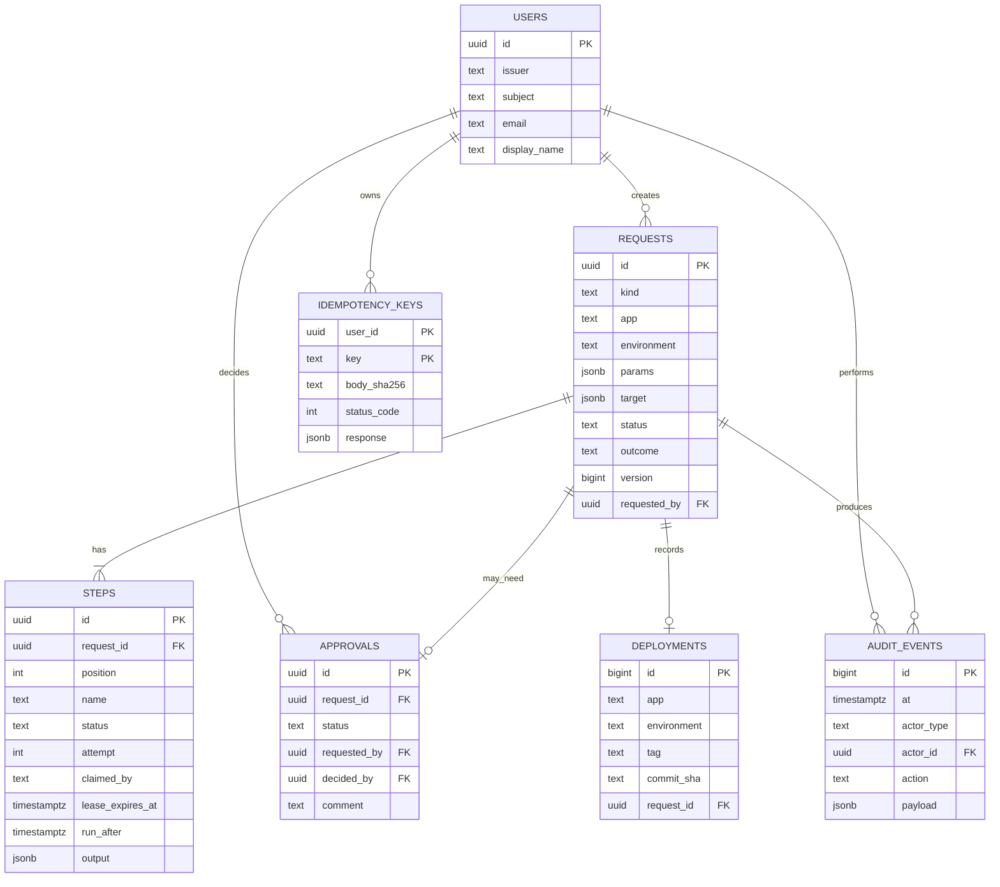

# Data model

> **Status:** design. The tables come from the original README. Columns, types, indexes and the SQL below are the proposed first migration and may change during M1.

Postgres is the single source of truth for deployctl and also its job queue. This document gives the schema, the reasoning behind each constraint, and the queries that depend on them.

- [Overview](#overview)
- [Conventions](#conventions)
- [Tables](#tables)
- [Constraints that carry the design](#constraints-that-carry-the-design)
- [Important queries](#important-queries)
- [Roles and grants](#roles-and-grants)
- [Retention](#retention)
- [Migrations](#migrations)

---

## Overview



## Conventions

- Primary keys are UUIDv7 generated by the application (time-ordered, so B-tree inserts stay local) except for append-heavy tables (`audit_events`, `deployments`), which use `bigint` identity columns.
- All timestamps are `timestamptz`.
- Enumerations are `text` with a `CHECK` constraint rather than Postgres `ENUM` types, because adding a value to a `CHECK` is a simple migration and reordering is never needed.
- `jsonb` is used for data whose shape depends on request kind or step (`params`, `target`, `output`, `payload`). Anything that is filtered or joined on is a real column.

## Tables

### `users`

A reference to the identity provider's subject, plus a profile cache for display. deployctl does not store passwords, groups or roles.

```sql
CREATE TABLE users (
    id            uuid PRIMARY KEY,
    issuer        text NOT NULL,
    subject       text NOT NULL,
    email         text,
    display_name  text,
    is_machine    boolean NOT NULL DEFAULT false,
    first_seen_at timestamptz NOT NULL DEFAULT now(),
    last_seen_at  timestamptz NOT NULL DEFAULT now(),
    UNIQUE (issuer, subject)
);
```

`(issuer, subject)` is the identity. Email and name can change in the identity provider and are refreshed on each request. Never compare users by email.

### `requests`

```sql
CREATE TABLE requests (
    id            uuid PRIMARY KEY,
    kind          text NOT NULL CHECK (kind IN ('deploy', 'scale', 'rollback')),
    app           text NOT NULL,
    environment   text NOT NULL,
    params        jsonb NOT NULL,             -- {"tag": "..."} | {"replicas": 5} | {}
    target        jsonb NOT NULL,             -- resolved config snapshot, see below
    reason        text,
    status        text NOT NULL CHECK (status IN (
                      'pending', 'awaiting_approval', 'running',
                      'succeeded', 'failed', 'rejected', 'cancelled')),
    outcome       text CHECK (outcome IN ('applied', 'no_change')),
    from_value    text,                       -- filled by validate
    to_value      text,                       -- filled by validate
    commit_sha    text,                       -- filled by git_commit
    version       bigint NOT NULL DEFAULT 1,  -- bumped on every change; SSE event id
    requested_by  uuid NOT NULL REFERENCES users(id),
    created_at    timestamptz NOT NULL DEFAULT now(),
    updated_at    timestamptz NOT NULL DEFAULT now(),
    finished_at   timestamptz,
    CHECK ((status = 'succeeded') = (outcome IS NOT NULL))
);

CREATE UNIQUE INDEX requests_one_active
    ON requests (app, environment)
    WHERE status IN ('pending', 'awaiting_approval', 'running');

CREATE INDEX requests_app_env_created ON requests (app, environment, created_at DESC);
CREATE INDEX requests_requested_by    ON requests (requested_by, created_at DESC);
CREATE INDEX requests_status_active   ON requests (status) WHERE status IN ('pending', 'awaiting_approval', 'running');
```

`target` example:

```json
{
  "repo": "https://github.com/example/reconcile.git",
  "branch": "main",
  "values_file": "charts/reconcile/values-prod.yaml",
  "key": "backend.image.tag",
  "argocd_application": "reconcile-prod",
  "namespace": "demo-prod",
  "label_selector": "app=reconcile-backend",
  "requires_approval": true
}
```

### `steps`

Ordered steps per request, and the job queue.

```sql
CREATE TABLE steps (
    id               uuid PRIMARY KEY,
    request_id       uuid NOT NULL REFERENCES requests(id) ON DELETE CASCADE,
    position         int  NOT NULL,
    name             text NOT NULL CHECK (name IN (
                         'validate', 'approval_gate', 'git_commit',
                         'argocd_refresh', 'wait_healthy', 'finalize')),
    status           text NOT NULL CHECK (status IN (
                         'blocked', 'ready', 'running', 'waiting',
                         'succeeded', 'skipped', 'failed', 'cancelled')),
    attempt          int  NOT NULL DEFAULT 0,
    run_after        timestamptz NOT NULL DEFAULT now(),
    claimed_by       text,
    lease_expires_at timestamptz,
    first_started_at timestamptz,
    finished_at      timestamptz,
    message          text,              -- one line for the CLI, e.g. "2/3 pods ready"
    last_error       text,
    output           jsonb NOT NULL DEFAULT '{}',
    updated_at       timestamptz NOT NULL DEFAULT now(),
    UNIQUE (request_id, position),
    UNIQUE (request_id, name),
    CHECK ((status = 'running') = (claimed_by IS NOT NULL AND lease_expires_at IS NOT NULL))
);

-- The claim query scans only claimable rows.
CREATE INDEX steps_claimable ON steps (run_after)
    WHERE status = 'ready';
CREATE INDEX steps_leased ON steps (lease_expires_at)
    WHERE status = 'running';
```

The `CHECK` on `running` ensures a step is never "running" without an owner and a lease, which is what crash recovery relies on.

### `approvals`

```sql
CREATE TABLE approvals (
    id            uuid PRIMARY KEY,
    request_id    uuid NOT NULL UNIQUE REFERENCES requests(id) ON DELETE CASCADE,
    status        text NOT NULL CHECK (status IN ('pending', 'approved', 'rejected', 'cancelled')),
    requested_by  uuid NOT NULL REFERENCES users(id),   -- copy of requests.requested_by
    decided_by    uuid REFERENCES users(id),
    decided_at    timestamptz,
    comment       text,
    created_at    timestamptz NOT NULL DEFAULT now(),
    CHECK (decided_by IS NULL OR decided_by <> requested_by),
    CHECK ((status IN ('approved', 'rejected')) = (decided_by IS NOT NULL))
);

CREATE INDEX approvals_pending ON approvals (created_at) WHERE status = 'pending';
```

`CHECK (decided_by <> requested_by)` is the **no-self-approval rule in the schema**. The policy code checks it first and returns a friendly `403`; the constraint guarantees that no code path, present or future, can store a self-approval.

### `deployments`

History of successful deploys and rollbacks per app and environment, used to choose rollback targets and to show "last deployed by".

```sql
CREATE TABLE deployments (
    id           bigint GENERATED ALWAYS AS IDENTITY PRIMARY KEY,
    app          text NOT NULL,
    environment  text NOT NULL,
    tag          text NOT NULL,
    commit_sha   text NOT NULL,
    request_id   uuid NOT NULL UNIQUE REFERENCES requests(id),
    deployed_by  uuid NOT NULL REFERENCES users(id),
    deployed_at  timestamptz NOT NULL DEFAULT now()
);

CREATE INDEX deployments_app_env ON deployments (app, environment, deployed_at DESC);
```

`UNIQUE (request_id)` makes `finalize` idempotent: a second run's insert conflicts and is ignored (`ON CONFLICT (request_id) DO NOTHING`).

### `audit_events`

```sql
CREATE TABLE audit_events (
    id           bigint GENERATED ALWAYS AS IDENTITY PRIMARY KEY,
    at           timestamptz NOT NULL DEFAULT now(),
    actor_type   text NOT NULL CHECK (actor_type IN ('user', 'system')),
    actor_id     uuid REFERENCES users(id),
    on_behalf_of uuid REFERENCES users(id),     -- for system actions, the requester
    action       text NOT NULL,                 -- e.g. 'approval.approved'
    app          text,
    environment  text,
    request_id   uuid REFERENCES requests(id),
    outcome      text NOT NULL CHECK (outcome IN ('success', 'failure', 'denied')),
    client_ip    inet,
    user_agent   text,
    payload      jsonb NOT NULL DEFAULT '{}',
    CHECK ((actor_type = 'user') = (actor_id IS NOT NULL))
);

CREATE INDEX audit_at          ON audit_events (at DESC);
CREATE INDEX audit_actor       ON audit_events (actor_id, at DESC);
CREATE INDEX audit_app_env     ON audit_events (app, environment, at DESC);
CREATE INDEX audit_request     ON audit_events (request_id);

CREATE FUNCTION audit_events_immutable() RETURNS trigger AS $$
BEGIN
    RAISE EXCEPTION 'audit_events is append-only';
END;
$$ LANGUAGE plpgsql;

CREATE TRIGGER audit_events_no_update_delete
    BEFORE UPDATE OR DELETE ON audit_events
    FOR EACH ROW EXECUTE FUNCTION audit_events_immutable();

CREATE TRIGGER audit_events_no_truncate
    BEFORE TRUNCATE ON audit_events
    FOR EACH STATEMENT EXECUTE FUNCTION audit_events_immutable();
```

Two layers protect the log: `deployctl_app` has only `INSERT` and `SELECT` on it, and the triggers raise for anyone (except a superuser who disables them, which is outside the threat model).

### `idempotency_keys`

```sql
CREATE TABLE idempotency_keys (
    user_id      uuid NOT NULL REFERENCES users(id),
    key          text NOT NULL CHECK (length(key) <= 255),
    endpoint     text NOT NULL,
    body_sha256  text NOT NULL,
    status_code  int,                  -- NULL while the first request is in flight
    response     jsonb,
    created_at   timestamptz NOT NULL DEFAULT now(),
    PRIMARY KEY (user_id, key)
);

CREATE INDEX idempotency_keys_created ON idempotency_keys (created_at);
```

Keys are scoped per user, so two users cannot collide or read each other's responses.

## Constraints that carry the design

| Rule | Enforced by | Also checked in code? |
|---|---|---|
| One active request per app and environment | `requests_one_active` partial unique index | No. The insert simply fails and the API maps the error to `409`. Checking first would be a race. |
| No self-approval | `approvals` `CHECK` | Yes, for a clear `403`. |
| Audit log is append-only | Grants + triggers | — |
| A running step always has an owner and a lease | `steps` `CHECK` | — |
| `finalize` writes history once | `deployments.request_id` `UNIQUE` | — |
| One approval per request | `approvals.request_id` `UNIQUE` | — |
| `outcome` set iff succeeded | `requests` `CHECK` | — |

The principle: **if a rule would be a security or correctness bug when broken, the database enforces it**, and the code checks it too only to produce a better error message.

## Important queries

### Create a request (API)

```sql
BEGIN;
INSERT INTO requests (id, kind, app, environment, params, target, reason, status, requested_by)
VALUES ($1, 'deploy', 'backend', 'prod', '{"tag":"e4f5a6b"}', $target, $reason, 'pending', $user);
-- unique violation on requests_one_active -> ROLLBACK, return 409

INSERT INTO steps (id, request_id, position, name, status) VALUES
  ($s1, $1, 1, 'validate',       'ready'),
  ($s2, $1, 2, 'approval_gate',  'blocked'),
  ($s3, $1, 3, 'git_commit',     'blocked'),
  ($s4, $1, 4, 'argocd_refresh', 'blocked'),
  ($s5, $1, 5, 'wait_healthy',   'blocked'),
  ($s6, $1, 6, 'finalize',       'blocked');

INSERT INTO audit_events (actor_type, actor_id, action, app, environment, request_id, outcome, client_ip, user_agent, payload)
VALUES ('user', $user, 'request.created', 'backend', 'prod', $1, 'success', $ip, $ua, '{"tag":"e4f5a6b"}');

UPDATE idempotency_keys SET status_code = 202, response = $resp WHERE user_id = $user AND key = $key;

SELECT pg_notify('request_updated', $1::text);
SELECT pg_notify('step_ready', '');
COMMIT;
```

### Claim a step (worker)

See [request-lifecycle.md](request-lifecycle.md#the-worker-loop). The `steps_claimable` and `steps_leased` partial indexes keep it an index scan regardless of history size.

### Advance after a step (worker)

```sql
BEGIN;
UPDATE steps
SET    status = 'succeeded', finished_at = now(), message = $msg, output = $out,
       claimed_by = NULL, lease_expires_at = NULL, updated_at = now()
WHERE  id = $step AND claimed_by = $me AND attempt = $attempt;
-- 0 rows -> lost the lease; ROLLBACK and discard

UPDATE steps SET status = 'ready', run_after = now(), updated_at = now()
WHERE  request_id = $req AND position = $pos + 1 AND status = 'blocked';

UPDATE requests SET status = $new_status, version = version + 1, updated_at = now()
WHERE  id = $req AND status IN ('pending', 'running');
-- 0 rows -> request was cancelled meanwhile; ROLLBACK

SELECT pg_notify('request_updated', $req::text);
SELECT pg_notify('step_ready', '');
COMMIT;
```

### Rollback target (worker, `validate`)

```sql
SELECT tag
FROM   deployments
WHERE  app = $1 AND environment = $2 AND tag <> $current_tag_in_git
ORDER  BY deployed_at DESC
LIMIT  1;
```

### Pending approvals I can decide (API)

```sql
SELECT a.*, r.*
FROM   approvals a JOIN requests r ON r.id = a.request_id
WHERE  a.status = 'pending' AND a.requested_by <> $me
ORDER  BY a.created_at;
```

## Roles and grants

```sql
CREATE ROLE deployctl_migrate LOGIN;      -- owns the schema
CREATE ROLE deployctl_app     LOGIN;

-- run as deployctl_migrate after creating tables
GRANT USAGE ON SCHEMA public TO deployctl_app;
GRANT SELECT, INSERT, UPDATE, DELETE
    ON users, requests, steps, approvals, deployments, idempotency_keys
    TO deployctl_app;
GRANT SELECT, INSERT ON audit_events TO deployctl_app;
GRANT USAGE ON ALL SEQUENCES IN SCHEMA public TO deployctl_app;
REVOKE CREATE ON SCHEMA public FROM PUBLIC;
```

`deployctl_app` can `DELETE` from `idempotency_keys` (for expiry) and, in principle, from the others; deleting requests is not part of any code path. A stricter setup can revoke `DELETE` on `requests`, `steps`, `approvals` and `deployments` and run retention as `deployctl_migrate`.

## Retention

| Table | Retention | How |
|---|---|---|
| `idempotency_keys` | 24 hours | Worker deletes rows older than 24h every 10 minutes. *(proposed)* |
| `requests`, `steps`, `approvals` | Indefinite in v1 | Volume is small (hundreds of rows per day). Revisit at a million rows. |
| `deployments` | Indefinite | Needed for rollback and history. |
| `audit_events` | Indefinite | Compliance. If archival is needed, partition by month and detach old partitions as the migration role. |
| `steps.output.diagnostics` | 30 days *(proposed)* | Nulled by a retention job; logs may contain sensitive data. |

## Migrations

- Plain numbered SQL files in `migrations/` (`0001_init.up.sql`, `0001_init.down.sql`), applied by `deployctl migrate` using a migration library (for example `golang-migrate` or `goose`), recorded in a `schema_migrations` table.
- Migrations run as `deployctl_migrate`, as an Argo CD `PreSync` hook, before new API and worker pods start.
- Every migration must be **compatible with the previous release's code**, because during a rollout old and new pods run together: add columns as nullable or with defaults, backfill, and only drop or tighten in a later release.
- `make db-reset` drops and recreates the local database and runs all migrations.
