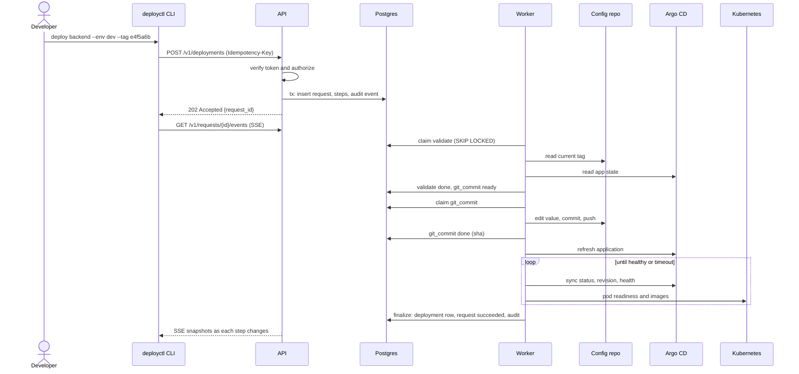
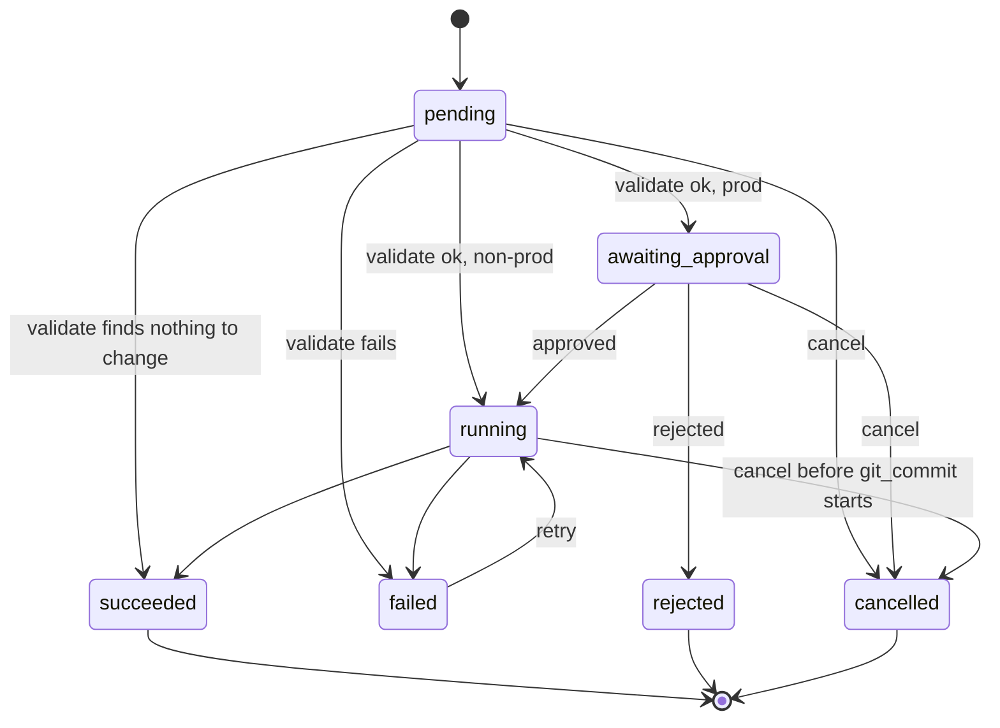
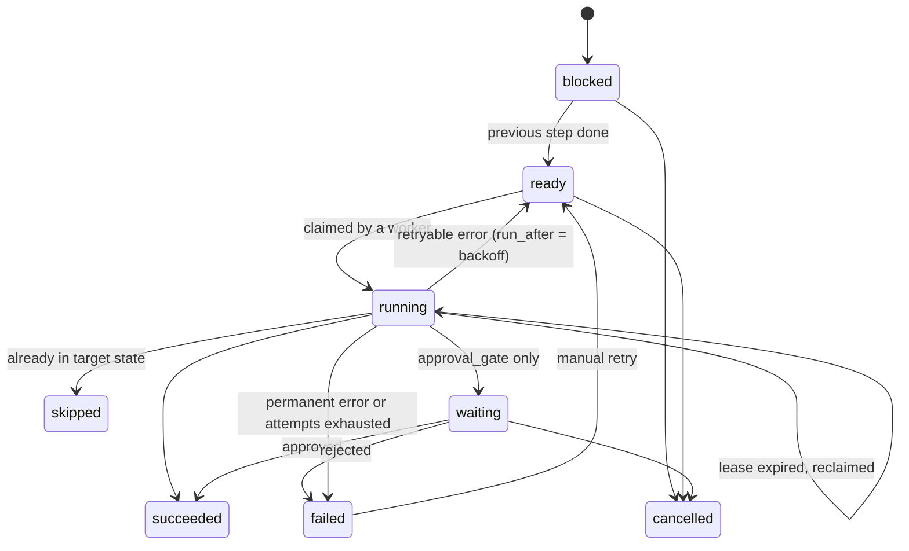

# Request lifecycle

> **Status:** design. This is the normative description of how a request moves from "accepted" to "done". Details beyond the original README (step statuses, lease timings, retry limits, the `no_change` outcome) are proposals and are marked *(proposed)* where they introduce a number or a new rule.

- [Overview](#overview)
- [Request kinds](#request-kinds)
- [Creating a request](#creating-a-request)
- [Request states](#request-states)
- [Step states](#step-states)
- [Steps](#steps)
- [The worker loop](#the-worker-loop)
- [Leases, heartbeats and fencing](#leases-heartbeats-and-fencing)
- [Automatic step retries](#automatic-step-retries)
- [Manual retry](#manual-retry)
- [Cancel](#cancel)
- [Approvals](#approvals)
- [Concurrency](#concurrency)
- [Idempotency](#idempotency)
- [Progress streaming](#progress-streaming)
- [Worked example](#worked-example)
- [Open questions](#open-questions)

---

## Overview

Every mutating command follows the same pattern:

> **record intent → authorise → gate → change Git → nudge Argo CD → watch → report**

The API does the first two synchronously and returns `202 Accepted`. Everything else is done by the worker, one **step** at a time, with every state change written to Postgres before the next action.



## Request kinds

| Kind | Parameter | What `git_commit` changes | Approval in prod |
|---|---|---|---|
| `deploy` | `tag` | `imageTagKey` → `tag` | yes |
| `scale` | `replicas` | `replicasKey` → `replicas` | yes |
| `rollback` | none | `imageTagKey` → last good tag (resolved by `validate`) | yes |

All three share one pipeline. Only `validate` (what to check, what the target is) and `git_commit` (which key to edit) differ by kind.

## Creating a request

`POST /v1/deployments`, `/v1/scalings` and `/v1/rollbacks` all do the same thing:

1. **Authenticate** the bearer token → principal (user ID, groups, roles).
2. **Idempotency check.** If `Idempotency-Key` was sent and is known for this user: same body hash → return the stored response; different hash → `422`.
3. **Validate the body** against the loaded config: the app and environment exist; `tag` matches `^[A-Za-z0-9_][A-Za-z0-9_.-]{0,127}$` (the OCI tag grammar); `replicas` is between 0 and the per-app maximum (default 50 *(proposed)*).
4. **Authorise** with `Policy.Authorize(principal, action, app, env)`, where the action is `deploy:nonprod` or `deploy:prod:request` depending on whether the environment has `requiresApproval: true`.
5. **Resolve the target.** Copy the resolved app and environment configuration (repo, branch, values file, key, Argo CD application, namespace, label selector) into `requests.target`. The worker uses this snapshot, not the live config, so a config reload while a request is in flight cannot redirect it.
6. **In one transaction:**
   - insert the `requests` row with status `pending`,
   - insert its `steps` rows (`validate` is `ready`; the rest are `blocked`),
   - insert an `audit_events` row (`request.created`),
   - store the idempotency key and the response,
   - `NOTIFY request_updated`.
   If the partial unique index on active requests rejects the insert, roll back and return `409` with the ID of the active request.
7. Return `202 Accepted` with `Location: /v1/requests/{id}`.

Steps created per environment:

| Environment | Steps |
|---|---|
| `requiresApproval: false` | `validate`, `git_commit`, `argocd_refresh`, `wait_healthy`, `finalize` |
| `requiresApproval: true` | `validate`, `approval_gate`, `git_commit`, `argocd_refresh`, `wait_healthy`, `finalize` |

### Dry run

`--dry-run` calls the same endpoint with `?dry_run=true`. The API runs steps 1–5 plus the read-only part of `validate` (current value, target, Argo CD state) inline and returns `200` with the plan. Nothing is stored, no audit event is written, and the idempotency key is ignored.

## Request states



| State | Meaning | Active? |
|---|---|---|
| `pending` | Accepted. `validate` has not finished. | yes |
| `awaiting_approval` | Validated. Waiting for an approver. | yes |
| `running` | Executing `git_commit` onward. | yes |
| `succeeded` | Finished. `outcome` is `applied` or `no_change`. | no |
| `failed` | A step failed permanently. Can be retried. | no |
| `rejected` | An approver said no. Terminal. | no |
| `cancelled` | Cancelled by the requester or an admin. Terminal. | no |

"Active" is what the one-active-request-per-app-and-environment index counts.

**Why `failed` is not active:** if it were, a failed request would block its app and environment until someone explicitly cancelled it. Instead, a failed request releases the lock, a new request can be made, and retrying the failed one must re-acquire the lock (see [Manual retry](#manual-retry)).

**`no_change`** *(proposed)*: deploying the tag that is already in Git is not an error. The request ends `succeeded` with `outcome = no_change`, the CLI prints "already deployed" and exits `0`. This keeps CI pipelines that redeploy on every merge idempotent.

## Step states



| Status | Meaning |
|---|---|
| `blocked` | An earlier step has not finished. |
| `ready` | May be claimed once `run_after <= now()`. |
| `running` | Claimed. `claimed_by` and `lease_expires_at` are set. |
| `waiting` | Parked on an external decision (only `approval_gate`). |
| `succeeded` / `skipped` | Done. `skipped` means the step found the work already done. |
| `failed` | Permanently failed. The request fails with it. |
| `cancelled` | The request was cancelled before this step ran. |

Exactly one step per request is in `ready`, `running` or `waiting` at any time. Advancing is always one transaction: mark step *n* done, mark step *n+1* `ready`, update the request, `NOTIFY`.

## Steps

Each step below lists what it reads, what it changes, how it stays idempotent, and how it fails. "Retryable" errors are retried automatically (see [Automatic step retries](#automatic-step-retries)); "permanent" errors fail the request.

### `validate`

Purpose: decide what the change is and whether it makes sense, without changing anything.

| | |
|---|---|
| Reads | Git: current value at the key in the values file (tip of the tracked branch). Argo CD: sync status, health. Kubernetes (scale only): whether an HPA targets the workload. Postgres (rollback only): `deployments` history. |
| Writes | `steps.output`: `from`, `to`, `warnings[]`. |
| Idempotency | Read-only. |
| Outcome | `succeeded`; or `no_change` (request ends `succeeded`); or a permanent failure. |

Rules:

- **deploy:** `to = tag`. If `from == to`, outcome `no_change`.
- **scale:** `to = replicas`. If an HPA targets the workload, fail with "this app is autoscaled; change the HPA's min/max instead". If `from == to`, `no_change`.
- **rollback:** `to` = the `tag` of the most recent row in `deployments` for this app and environment whose tag differs from `from`. If there is none, fail with "no earlier successful deployment to roll back to". Note this is "last good tag that is not what Git currently says", which is correct both after a bad deploy that failed `wait_healthy` (Git has the bad tag, which is not in `deployments`) and after a bad deploy that passed health checks but misbehaves (Git has the bad tag, which *is* the newest row; the previous row is chosen).
- **Warnings, not failures:** Argo CD health `Degraded` or `Missing`, or sync status `OutOfSync`, adds a warning shown in the CLI and on the approval. Deploying a fix to a broken app must be possible.
- **Permanent failures:** values file or key not found; Argo CD application not found; config snapshot invalid.
- **Retryable:** Git or Argo CD unreachable, timeouts, 5xx.

### `approval_gate`

Production only. Creates an `approvals` row with status `pending`, sets the step to `waiting` and the request to `awaiting_approval`, all in one transaction. The worker then **releases** the step; no worker is occupied while a human decides.

The API's decision endpoint completes the gate:

- **approve:** approval `approved`, step `succeeded`, `git_commit` `ready`, request `running`, audit event, `NOTIFY` — one transaction.
- **reject:** approval `rejected`, step `failed`, remaining steps `cancelled`, request `rejected`, audit event — one transaction.

The decider must hold `approval:decide` and must not be the requester. See [Approvals](#approvals).

### `git_commit`

Purpose: make the desired state in Git equal the target.

Algorithm:

1. **Look for our own commit.** Search the last 200 commits *(proposed)* on the tracked branch for the trailer `Deployctl-Request: <request_id>`. If found, record its SHA and succeed. This covers the crash window between `git push` succeeding and the database update.
2. **Fetch** the branch into the worker's cached clone and read the current value.
3. If the current value already equals `to`, outcome `skipped`, output `sha` = current branch tip. Someone (or an earlier attempt) already did it.
4. **Edit** the value with the YAML node editor (comments and key order preserved; see [ADR 0011](../adr/0011-edit-yaml-with-the-node-api.md)).
5. **Commit** with the message below, as the GitHub App's bot identity.
6. **Push.** On non-fast-forward, go back to step 2 (re-fetch and re-apply the edit on the new tip). Give up after 5 attempts *(proposed)* with a retryable error.
7. Record `sha` in `steps.output`.

Commit message:

```
deploy(backend/prod): 9f8e7d6 -> e4f5a6b

Requested-by: linh@example.com
Approved-by: priya@example.com

Deployctl-Request: 0b8e2c1a-5d7f-4a1e-9c3b-2f6e8d1a7b40
```

The subject uses `deploy`, `scale` or `rollback`. `Approved-by` appears only for approved requests. The trailers make `git log` a second, independent audit trail.

Failure classes:

| Error | Class |
|---|---|
| Network error, GitHub 5xx, rate limited | retryable |
| Non-fast-forward after 5 attempts | retryable (the next automatic retry starts over) |
| Push rejected by branch protection (`GH006`) | permanent, with a hint about the App bypass or pull request mode |
| Values file or key missing | permanent |
| Installation token cannot be minted (bad key, App uninstalled) | permanent |

**Point of no return.** Once `git_commit` has started, the request can no longer be cancelled; see [Cancel](#cancel).

### `argocd_refresh`

Ask Argo CD to compare against Git now (`GET /api/v1/applications/{name}?refresh=normal`) instead of waiting up to its polling interval (3 minutes by default).

- If `AppState.AutoSync` is true (the expected setup), refresh is enough; Argo CD syncs on its own once it sees the new revision.
- If it is false, including when `automated.enabled: false`, the step also calls `POST /api/v1/applications/{name}/sync` with `revision = sha`. See the [AutoSync mapping rules](configuration.md#mapping-to-the-config-repo). *(proposed)*
- Refresh is safe to repeat. Before repeating a manual sync after an uncertain
  response, inspect `AppState.Operation` and its revision to distinguish a pending,
  running or completed sync from an older operation. See the [operation snapshot
  contract](architecture.md#key-interfaces). Retryable on network errors; permanent
  on `403` or `404` (misconfigured token or application name).

### `wait_healthy`

Purpose: prove the change is live and healthy, or fail with enough information to act.

The step polls every `worker.pollInterval` (default `5s`) until `worker.rolloutTimeout` (default `5m`) has passed **since the step first started** (`steps.first_started_at`, so a worker crash does not reset the clock).

`AppState.SyncRevision` maps directly to Argo CD's `status.sync.revision`: the Git
revision used for the latest comparison. It can point to the new commit while the
application is still `OutOfSync`, so the revision alone does not prove a successful
rollout.

Success requires **all** of:

1. Argo CD `sync.status == Synced`.
2. Argo CD `sync.revision` is `sha` **or a descendant of it** (another commit may have landed after ours; the worker checks ancestry in its clone). Without this check the step could pass on the *old* revision, which is also `Synced` and `Healthy` for a moment after the push.
3. Argo CD `health.status == Healthy`.
4. Kubernetes: every pod matched by `labelSelector` in the namespace is `Ready`, and none is terminating.
5. For `deploy` and `rollback`: every matched pod's container image ends with `:<to>` (or the pods' image digest matches, if the chart pins digests).
6. For `scale`: the number of ready pods equals `to`.

Early failure *(proposed)*: if Argo CD reports `Degraded` with a progress deadline exceeded, or any matched pod has restarted 3 or more times since the step started (CrashLoopBackOff), fail without waiting for the timeout.

On failure, the step captures **diagnostics** into `steps.output.diagnostics`:

- the last 20 Kubernetes events for the matched pods and their ReplicaSet,
- the last 50 log lines of each non-ready container (the previous instance if it restarted),
- the Argo CD health message.

Diagnostics are capped at 64 KiB per request and are shown by `deployctl request <id>`. Logs can contain sensitive data, so diagnostics are visible only to roles that can deploy to that environment *(proposed)*.

`wait_healthy` failing does **not** roll back. The new tag is in Git and stays there until someone requests a rollback. See [ADR 0009](../adr/0009-no-automatic-rollback.md).

### `finalize`

One transaction:

- for `deploy` and `rollback`, insert into `deployments (app, environment, tag, commit_sha, request_id, deployed_at)`; the unique constraint on `request_id` makes a second run a no-op,
- mark the step `succeeded` and the request `succeeded` with `outcome = applied`,
- insert the `request.succeeded` audit event,
- `NOTIFY request_updated`.

## The worker loop

Each worker process runs `worker.concurrency` (default 4 *(proposed)*) goroutines, each doing:

```
loop:
    step := claim()                  // short transaction, see below
    if none: wait for NOTIFY step_ready or 2s, continue
    ctx := context with lease heartbeat
    result, err := steps[step.name].Run(ctx, input)
    complete(step, result, err)      // short transaction, fenced
```

The claim:

```sql
UPDATE steps s
SET    status           = 'running',
       claimed_by       = $1,                         -- worker instance ID
       lease_expires_at = now() + interval '30 seconds',
       attempt          = s.attempt + 1,
       first_started_at = coalesce(s.first_started_at, now()),
       updated_at       = now()
WHERE  s.id = (
    SELECT s2.id
    FROM   steps s2
    JOIN   requests r ON r.id = s2.request_id
    WHERE  r.status IN ('pending', 'running')
      AND (   (s2.status = 'ready'   AND s2.run_after <= now())
           OR (s2.status = 'running' AND s2.lease_expires_at < now()))
    ORDER  BY s2.run_after
    FOR UPDATE OF s2 SKIP LOCKED
    LIMIT  1
)
RETURNING s.*;
```

`SKIP LOCKED` means two workers running this at once each get a different row (or none) instead of blocking each other. The transaction is short; the row lock is **not** held while the step runs. Ownership during the run is expressed by `claimed_by` and the lease.

## Leases, heartbeats and fencing

- **Lease:** 30 seconds from claim *(proposed)*.
- **Heartbeat:** while a step runs, the worker extends the lease every 10 seconds: `UPDATE steps SET lease_expires_at = now() + interval '30 seconds' WHERE id = $1 AND claimed_by = $2 AND attempt = $3`.
- **Lost lease:** if the heartbeat updates zero rows, another worker has taken over. The goroutine cancels the step's context and drops its result.
- **Fencing on completion:** every completion `UPDATE` includes `WHERE claimed_by = $me AND attempt = $n`. A slow worker that wakes up after its lease expired and another worker reclaimed the step cannot overwrite the newer attempt's result.
- **Crash:** a crashed worker stops heartbeating, the lease expires within 30 seconds, and the claim query picks the step up again (`status = 'running' AND lease_expires_at < now()`). Because every step is idempotent, re-running it is safe.

Fencing protects the database; it does not stop a zombie worker from performing an external side effect late. That is why `git_commit` is idempotent on its own (trailer search, value comparison) rather than relying on fencing.

## Automatic step retries

Retryable errors are retried by the queue, not by sleeping in the goroutine:

- the step goes back to `ready` with `run_after = now() + backoff`,
- backoff is exponential with jitter: 2s, 4s, 8s, 16s, 32s *(proposed)*,
- after 5 attempts *(proposed)* the step fails permanently and the request fails.

`steps.attempt` counts every claim, including reclaims after a lost lease. `steps.last_error` keeps the most recent error message.

## Manual retry

`POST /v1/requests/{id}/retry` (or `deployctl retry <id>`):

- allowed for the requester (with `request:manage` on their own requests) or an admin,
- only from `failed`,
- **resumes from the failed step**: that step goes to `ready` with its attempt counter reset to 0; completed steps are not re-run,
- moves the request back to `running`, which re-enters the active set. If another request for the same app and environment is active, the unique index rejects it and the API returns `409`,
- is refused with `409 superseded` *(proposed)* if a newer request for the same app and environment has been created since this one. Retrying an old deploy after a newer one has gone out would silently revert the newer one; make a new request instead.

A retried `git_commit` first searches for its trailer, so a request that failed *after* pushing does not commit twice.

## Cancel

`POST /v1/requests/{id}/cancel` is allowed while the request is `pending`, `awaiting_approval`, or `running` **and `git_commit` has not started**.

The cancel transaction locks the request row and the `git_commit` step row (`FOR UPDATE NOWAIT`):

- If the `git_commit` row is locked (a worker is claiming it right now) or its status is not `blocked`/`ready`, cancel returns `409` "too late to cancel, request a rollback instead".
- Otherwise: request `cancelled`, all non-finished steps `cancelled`, pending approval `cancelled`, audit event, `NOTIFY`.

If a `validate` step is running at the moment of cancel, its completion `UPDATE` finds the request no longer `pending` and discards the result.

Once a commit is pushed the change is real. The only way back is a rollback request, which is itself recorded and, in production, approved.

## Approvals

- One approval per production request. One decision completes it.
- The decider needs `approval:decide` (role `approver` or `admin`).
- **Nobody can approve their own request**, including admins. The check is `approval.requested_by != principal.user_id`, done in the decision transaction.
- The decision, comment and decider are stored on the `approvals` row, written to the audit log, and added to the commit message as `Approved-by`.
- Approvals do not expire in v1. See [Open questions](#open-questions).

What an approver sees (`deployctl approvals`, `GET /v1/approvals?status=pending`): app, environment, kind, `from → to`, requester, age, and the `validate` warnings. The intent is that an approver can make a decision without opening another tool.

## Concurrency

**One active request per app and environment**, enforced by a partial unique index:

```sql
CREATE UNIQUE INDEX requests_one_active
    ON requests (app, environment)
    WHERE status IN ('pending', 'awaiting_approval', 'running');
```

A second request for the same app and environment while one is active gets `409 Conflict` with the active request's ID. This stops two requests from racing on the same values file and makes "what is happening to backend/prod right now" a single row.

Across different apps or environments there is no limit beyond worker capacity. Requests for different apps that share one config repo can still race at the Git level (both push to `main`); that is handled by re-fetch and re-apply in `git_commit`, because the edits touch different files or keys and never conflict semantically.

## Idempotency

Two layers, for two different failure windows. See [ADR 0008](../adr/0008-idempotency-at-api-and-step-level.md).

**API level (client retries).** Mutating endpoints accept `Idempotency-Key` (any string up to 255 characters; the CLI sends a UUIDv4). The server stores `(user_id, key) → (body_sha256, status_code, response_body)` for 24 hours *(proposed)*.

| Situation | Response |
|---|---|
| New key | Process normally and store the response |
| Same key, same body | Return the stored response; nothing new is created |
| Same key, different body | `422 Unprocessable Content` |
| Same key, first request still in flight | `409` with `Retry-After: 1` |

**Step level (worker crashes).** Every step checks current state before acting. `git_commit` additionally finds its own previous commit by trailer.

## Progress streaming

`GET /v1/requests/{id}/events` returns `text/event-stream`. Each event is a **full snapshot** of the request and its steps, not a delta:

```
event: snapshot
id: 7
data: {"id":"0b8e...","status":"running","version":7,"steps":[{"name":"validate","status":"succeeded","message":"a1b2c3d → e4f5a6b"},{"name":"git_commit","status":"succeeded","message":"pushed 3c2d1e0"},{"name":"argocd_refresh","status":"succeeded"},{"name":"wait_healthy","status":"running","message":"2/3 pods ready"},{"name":"finalize","status":"blocked"}]}
```

- `id` is `requests.version`, incremented on every change.
- On connect, the server sends the current snapshot immediately.
- When the request reaches a terminal state, the server sends a final snapshot and `event: end`, then closes the stream.
- A `: keepalive` comment is sent every 15 seconds so proxies do not close idle connections.
- Reconnecting is trivial: the client reconnects and gets the latest snapshot. There is no event log to replay. See [ADR 0010](../adr/0010-sse-snapshots-for-progress.md).

`wait_healthy` updates its step `message` (for example "2/3 pods ready") on each poll where the message changes, which bumps `version` and produces a snapshot.

## Worked example

A production deploy of `backend` from `9f8e7d6` to `e4f5a6b`, requested by Linh and approved by Priya:

| Time | Actor | Event | Request status | Step changes |
|---|---|---|---|---|
| 10:00:00 | Linh (CLI) | `POST /v1/deployments` | `pending` | validate `ready`, others `blocked` |
| 10:00:01 | worker-a | claims validate | `pending` | validate `running` |
| 10:00:02 | worker-a | from `9f8e7d6`, to `e4f5a6b`, Argo CD Healthy | `pending` | validate `succeeded`, approval_gate `ready` |
| 10:00:02 | worker-b | claims approval_gate, creates approval | `awaiting_approval` | approval_gate `waiting` |
| 10:14:30 | Priya (CLI) | approves | `running` | approval_gate `succeeded`, git_commit `ready` |
| 10:14:31 | worker-a | claims git_commit, pushes `3c2d1e0` | `running` | git_commit `succeeded`, argocd_refresh `ready` |
| 10:14:32 | worker-b | refresh | `running` | argocd_refresh `succeeded`, wait_healthy `ready` |
| 10:14:32 | worker-b | polls | `running` | wait_healthy `running` ("0/5 ready") |
| 10:15:20 | worker-b | Synced at `3c2d1e0`, Healthy, 5/5 ready on `:e4f5a6b` | `running` | wait_healthy `succeeded` |
| 10:15:20 | worker-a | finalize | `succeeded` (`applied`) | finalize `succeeded` |

Audit events written: `request.created`, `approval.requested`, `approval.approved`, `git.committed`, `request.succeeded`.

## Open questions

| Question | Current answer | Revisit when |
|---|---|---|
| Should approvals expire? An approval given on Monday for a deploy that runs on Friday is stale. | No expiry in v1. `git_commit` re-checks the current value, so a stale approval cannot clobber a newer change silently, but it can still ship an old tag. | First real production use. Likely: expire after 24 hours, configurable per environment. |
| Should `validate` run again after approval? | No. `git_commit` re-reads the current value, and `wait_healthy` checks the result. | If warnings at approval time turn out to matter. |
| Long `wait_healthy` holds a worker goroutine for up to `rolloutTimeout`. | Acceptable at this scale. | If many slow rollouts starve the queue. Then: make `wait_healthy` return `Waiting` with a `run_after` and re-claim per poll. |
| `git` CLI or a pure Go library in the worker? | Shell out to `git` with a cached clone per worker. Simpler and matches what humans run. | If the container image size or process overhead becomes a problem. |
| Diagnostics visibility | Developers and above for the environment. | If per-app permissions are added. |
