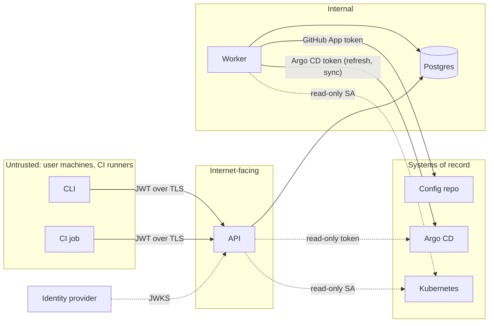
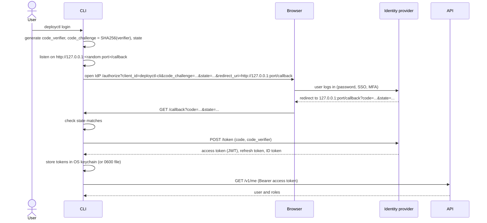
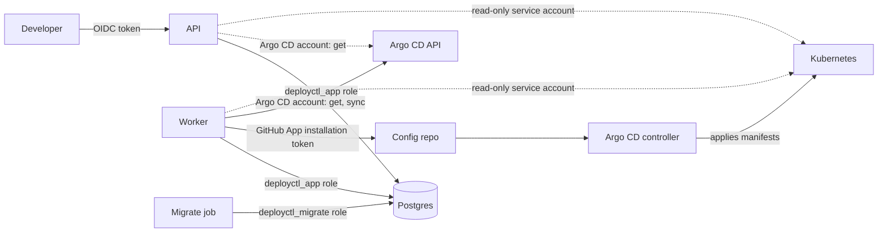

# Security

> **Status:** design. This document covers who can do what, which component holds which credential, and what happens when each part is compromised. Items marked *(proposed)* go beyond the original README.

- [Security goals](#security-goals)
- [Trust boundaries](#trust-boundaries)
- [Authentication](#authentication)
- [Authorization](#authorization)
- [Approvals and separation of duties](#approvals-and-separation-of-duties)
- [Credentials and least privilege](#credentials-and-least-privilege)
- [Audit log](#audit-log)
- [Threat model](#threat-model)
- [Hardening checklist](#hardening-checklist)
- [Known gaps](#known-gaps)

---

## Security goals

1. **No standing human access to production.** Developers do not need cluster credentials or write access to the config repo to ship.
2. **Every change is attributable** to an authenticated person or machine identity, and the record cannot be edited by the application.
3. **Production changes require two people.** One requests, a different one approves.
4. **Compromise of one component has a bounded blast radius.** In particular, compromising the internet-facing API must not give direct write access to Git or the cluster.
5. **No long-lived secrets** where a short-lived alternative exists.

Non-goals: protecting against a malicious cluster administrator, a malicious identity provider administrator, or someone with admin rights on the config repo. Those people are outside deployctl's control by definition.

## Trust boundaries



Everything crossing from **Untrusted** into **Edge** is authenticated and authorised. Everything crossing from **Core** into **Systems** uses a credential scoped to the minimum needed. The API → Postgres → worker path is the one place where an Edge component can influence a write; the controls on that path are discussed in the [threat model](#threat-model).

## Authentication

### Users: OIDC Authorization Code flow with PKCE



- The CLI is a **public client**: it has no client secret, because anything shipped in a binary is not secret. PKCE replaces the secret by proving that the party redeeming the code is the one that started the flow.
- The redirect goes to a **loopback address** on a random port (RFC 8252). No custom URL schemes, no copy-pasting codes.
- `state` protects against a malicious page feeding the CLI a code from a different login.
- Tokens are stored in the OS keychain (macOS Keychain, Windows Credential Manager, Secret Service on Linux). If none is available, `~/.config/deployctl/tokens.json` with mode `0600`, and a warning.
- The CLI refreshes the access token with the refresh token when it is within 60 seconds of expiry. `deployctl logout` deletes local tokens and calls the provider's revocation endpoint if it has one.
- Recommended identity provider settings: access token lifetime 5–15 minutes; refresh token lifetime of a working day; MFA required for members of approver and admin groups.

### Machines: client credentials or injected tokens

CI pipelines and scripts must not use a person's login.

- **Client credentials flow:** a confidential OIDC client per pipeline (for example `ci-backend`), with its own groups. The client secret lives in the CI system's secret store.
- **Federated CI tokens** *(recommended)*: many CI systems (GitHub Actions, GitLab) can mint a short-lived OIDC token per job. If your identity provider can exchange or trust those, no long-lived CI secret is needed at all.
- Either way, the token is passed to the CLI as `DEPLOYCTL_TOKEN`. The CLI does not try to refresh it.
- Machine identities are usually mapped to `developer` and, by policy, allowed only non-production environments. *(proposed: a `machine` marker in the role mapping so production requests from machines can be refused outright.)*

### Token verification in the API

For every request except `/healthz` and `/readyz`:

1. Extract `Authorization: Bearer <jwt>`. Missing → `401`.
2. Parse the header; reject `alg: none` and any algorithm not in the allow-list (`RS256`, `ES256`).
3. Find the key by `kid` in the cached JWKS. Unknown `kid` → refetch the JWKS once (rate limited to once per minute) to pick up key rotation, then fail if still unknown.
4. Verify the signature.
5. Check `iss == auth.issuer`, `aud` contains `auth.audience`, `exp > now`, `nbf <= now`, allowing 60 seconds of clock skew.
6. Read `sub` (required) and the groups claim (`auth.groupsClaim`).
7. Upsert the user into `users` by `(issuer, sub)` and update the cached display name and email.
8. Map groups to roles. A user whose groups map to no role gets `403` with "no deployctl role": they are authenticated, but not a deployctl user.

The JWKS is cached in memory and refreshed every 10 minutes *(proposed)*. If the identity provider is down, previously cached keys keep working, so existing tokens remain valid until they expire. New logins fail.

### Dev auth mode

`--auth=dev` replaces all of the above with a fixed token and identity, for local development of the lifecycle without an identity provider.

- It **must refuse to start** if the listen address is not loopback (`127.0.0.1`, `::1`, `localhost`).
- It logs a warning on every request.
- The binary refuses `--auth=dev` when `DEPLOYCTL_ENV=production` is set *(proposed)*, as a second guard.

## Authorization

### Roles

Roles are derived from the identity provider's group claim through `auth.roleMapping`. deployctl does not store memberships; removing someone from a group in the identity provider removes their access as soon as their current access token expires.

| Role | Includes | Adds |
|---|---|---|
| `viewer` | — | Read apps, status, requests |
| `developer` | viewer | Deploy, scale, roll back non-prod; request prod changes; retry or cancel own requests |
| `approver` | developer | Approve or reject prod requests; read the audit log |
| `admin` | approver | Retry or cancel any request |

A user in several mapped groups gets the union of the roles.

### Actions

| Action | Constant | viewer | developer | approver | admin |
|---|---|---|---|---|---|
| Read apps, status, requests | `read` | ✓ | ✓ | ✓ | ✓ |
| Deploy, scale, roll back non-prod | `deploy:nonprod` | | ✓ | ✓ | ✓ |
| Request a prod change | `deploy:prod:request` | | ✓ | ✓ | ✓ |
| Approve or reject a prod request | `approval:decide` | | | ✓ | ✓ |
| Retry or cancel own request | `request:manage` (owner) | | ✓ | ✓ | ✓ |
| Retry or cancel any request | `request:manage` (any) | | | | ✓ |
| Read the audit log | `audit:read` | | | ✓ | ✓ |

"Prod" means any environment with `requiresApproval: true`. The policy never matches on environment *names*.

### Policy code

All decisions go through one function in `internal/auth/policy.go`:

```go
type Action string

const (
    ActionRead           Action = "read"
    ActionDeployNonProd  Action = "deploy:nonprod"
    ActionRequestProd    Action = "deploy:prod:request"
    ActionApprovalDecide Action = "approval:decide"
    ActionRequestManage  Action = "request:manage"
    ActionAuditRead      Action = "audit:read"
)

type Principal struct {
    UserID  uuid.UUID
    Subject string
    Roles   RoleSet
    Machine bool
}

// Authorize returns nil if the principal may perform the action on the
// given app and environment, or an *auth.Denied error explaining why.
func (p *Policy) Authorize(ctx context.Context, who Principal, action Action, app, env string) error
```

- Handlers call `Authorize` **after** parsing the body, because the decision depends on the target app and environment.
- Ownership checks (`request:manage` on your own request, "not your own approval") need the stored request, so they are done in the handler with the row in hand, through helpers in the same package (`CanManageRequest`, `CanDecideApproval`) so they are still tested in one table.
- `app` is passed even though v1 roles are global. This keeps the signature stable for per-app scoping later (for example, team A's developers deploy only team A's apps).
- A denial returns `403` with a problem detail naming the missing action, never a `404`, except for reading a specific request the caller cannot see, which returns `404` to avoid leaking request IDs. *(proposed)*

### Testing the policy

A single table test enumerates every role × action × environment type, plus the ownership rules:

```go
{role: developer, action: ActionDeployNonProd,  env: "dev",  want: allow},
{role: developer, action: ActionDeployNonProd,  env: "prod", want: deny},   // must use RequestProd
{role: developer, action: ActionApprovalDecide, env: "prod", want: deny},
{role: approver,  action: ActionApprovalDecide, env: "prod", want: allow},
{role: admin,     action: ActionApprovalDecide, env: "prod", requester: self, want: deny},
...
```

Adding a role or action without updating this table fails the build (the test asserts the table covers the full cross product).

## Approvals and separation of duties

- Every request to an environment with `requiresApproval: true` gets an `approval_gate` step.
- The decision endpoint checks, inside the transaction that records the decision:
  1. the caller has `approval:decide`,
  2. the approval is still `pending`,
  3. `approvals.requested_by != caller.user_id`.
- The no-self-approval rule applies to **admins too**. There is no override flag. An organisation with a single person able to approve has a process problem that deployctl will surface, not hide.
- The approval decision and the approver's identity are written to the audit log and to the commit message (`Approved-by:`).

Because identity comes from `(issuer, sub)`, the check cannot be fooled by changing a display name or email.

## Credentials and least privilege

Every arrow is a credential with the narrowest scope that works. Dashed arrows are read-only.



| Component | Holds | Cannot do |
|---|---|---|
| User / CLI | Their own OIDC tokens | Touch Git, Argo CD or the cluster directly |
| API | `deployctl_app` DB role; Argo CD `get`; Kubernetes read | Push to Git, sync, change cluster state |
| Worker | `deployctl_app` DB role; GitHub App token for the config repo; Argo CD `get`/`sync`; Kubernetes read | Write to the cluster; push to any other repo |
| Migrate job | `deployctl_migrate` DB role | Anything outside the database |
| Argo CD controller | Cluster write access | Not used by deployctl |

### GitHub App

- Installed **only on the config repo**.
- Repository permissions: **Contents: read and write**, **Metadata: read**. Nothing else (no Actions, no Administration, no Pull requests until pull request mode exists).
- The worker holds the App's **private key** (a file mounted from a Kubernetes Secret or a secrets manager) and uses it to sign a short JWT, which it exchanges for an **installation token** valid for one hour. Tokens are cached and refreshed 5 minutes before expiry.
- Why not a personal access token: a PAT is tied to a person (who may leave), usually has access to every repo that person can see, and is long-lived. See [ADR 0006](../adr/0006-github-app-for-git-writes.md).
- Rotate the private key by generating a second key in the App settings, deploying it, then deleting the first. GitHub allows several active keys for exactly this.

### Argo CD accounts

Use dedicated local accounts, never `admin`:

```yaml
# argocd-cm
data:
  accounts.deployctl-worker: apiKey
  accounts.deployctl-api: apiKey
```

```csv
# argocd-rbac-cm, policy.csv
p, role:deployctl-worker, applications, get,  default/reconcile-*, allow
p, role:deployctl-worker, applications, sync, default/reconcile-*, allow
p, role:deployctl-api,    applications, get,  default/reconcile-*, allow
g, deployctl-worker, role:deployctl-worker
g, deployctl-api,    role:deployctl-api
```

- Scope the object pattern (`<project>/<application>`) to the applications deployctl manages, not `*/*`.
- A refresh is a `get` with `?refresh=normal` in current Argo CD versions; check against your version.
- Generate tokens with `argocd account generate-token --account deployctl-worker`, optionally with `--expires-in`, and store them as Kubernetes Secrets.

### Kubernetes

```yaml
apiVersion: rbac.authorization.k8s.io/v1
kind: ClusterRole
metadata:
  name: deployctl-read
rules:
  - apiGroups: [""]
    resources: ["pods", "events"]
    verbs: ["get", "list", "watch"]
  - apiGroups: [""]
    resources: ["pods/log"]
    verbs: ["get"]
  - apiGroups: ["apps"]
    resources: ["deployments", "replicasets"]
    verbs: ["get", "list", "watch"]
  - apiGroups: ["autoscaling"]
    resources: ["horizontalpodautoscalers"]
    verbs: ["get", "list"]
```

Bind it with a `RoleBinding` in each managed namespace (preferred) rather than a `ClusterRoleBinding`, so deployctl cannot read pods in namespaces it does not manage. Notably absent: `secrets`, and every write verb.

### Postgres

| Role | Privileges |
|---|---|
| `deployctl_migrate` | Owns the schema. DDL. Used only by `deployctl migrate`. |
| `deployctl_app` | `SELECT, INSERT, UPDATE, DELETE` on operational tables; **`SELECT, INSERT` only** on `audit_events`; no DDL. |

A trigger on `audit_events` additionally raises on `UPDATE` and `DELETE`, so even a mistaken grant does not make the log mutable. See [data-model.md](data-model.md#audit_events).

### Secrets handling

- No secrets in Git and none in `deployctl.config.yaml`. Service credentials come from environment variables, mounted files, or a secrets manager.
- Application secrets (database passwords for `backend`, and so on) are out of scope. Use Sealed Secrets, External Secrets or SOPS in the config repo.
- Structured logs never include tokens. The logging middleware redacts the `Authorization` header and any field named `token`, `secret` or `password`.

## Audit log

Every state change produces an `audit_events` row in the **same transaction** as the change, so the log cannot miss an action that happened or record one that did not.

| Event | Actor | When |
|---|---|---|
| `request.created` | user | API accepts a request |
| `request.no_change` | system | `validate` finds nothing to change |
| `approval.requested` | system | `approval_gate` runs |
| `approval.approved` / `approval.rejected` | user | decision |
| `git.committed` | system (on behalf of requester) | `git_commit` pushes |
| `request.succeeded` / `request.failed` | system | terminal state |
| `request.retried` / `request.cancelled` | user | manual action |
| `auth.denied` | user | a `403` on a mutating endpoint *(proposed)* |

Each row records actor (user ID or `system`), action, resource (`app/env`, request ID), outcome, client IP and user agent (for user actions), and a JSON payload (for example `{"from":"9f8e7d6","to":"e4f5a6b","sha":"3c2d1e0"}`).

The Git history is a second, independent trail: every commit names the requester, the approver and the request ID.

## Threat model

| # | Threat | Impact | Controls | Residual risk |
|---|---|---|---|---|
| T1 | Developer laptop stolen | Attacker uses stored tokens | Short access tokens; refresh token in OS keychain; revoke sessions at the identity provider; prod needs a second person | Non-prod deploys until revoked |
| T2 | CI secret leaked | Attacker deploys as CI | Machine identities limited to non-prod; prefer federated short-lived CI tokens; audit shows machine identity | Non-prod deploys of *existing* tags |
| T3 | Developer tries to ship to prod alone | Unreviewed prod change | `approval_gate`; no self-approval; no direct repo write | Collusion between two people |
| T4 | API compromised (RCE) | Attacker can write to Postgres as `deployctl_app` | API holds no Git or cluster write credential; worker re-reads target from request snapshot and only edits configured keys in configured files; tags validated against OCI grammar; audit log append-only | Attacker can insert a request with a forged `approved` approval row, and the worker would push it. See [Known gaps](#known-gaps) |
| T5 | Worker compromised | Attacker can push to the config repo | GitHub App scoped to one repo; branch protection on paths outside managed values files *(where supported)*; Git history shows bot commits without matching requests | Arbitrary changes to the config repo, therefore to the cluster |
| T6 | Argo CD token leaked | Attacker can sync managed apps | Token scoped to `get`/`sync` on managed apps; sync can only apply what is in Git | Forced resync; no new content |
| T7 | Human edits cluster directly | Drift, unrecorded change | Argo CD `selfHeal` reverts it; deployctl users hold no cluster access | Admins with cluster access remain outside deployctl |
| T8 | Human pushes to config repo directly | Bypasses approvals | Branch protection: only the GitHub App may push to the tracked branch; humans use pull requests with review | Repo admins can override |
| T9 | Mutable image tag re-pushed | Same tag, different code | Use immutable tags (Git SHAs) and enable tag immutability in the registry; *(later)* deploy by digest | If the registry allows overwrite, tag does not identify code |
| T10 | Log or diagnostic contains secrets | Exposure via `request` detail | Diagnostics restricted to deploy-capable roles; capped size | Apps that log secrets |
| T11 | Dev auth mode reachable | Anyone is admin | Loopback-only bind enforced; refused when `DEPLOYCTL_ENV=production` | Misbuilt image that strips checks |
| T12 | Identity provider group misassigned | Wrong person gets approver | Role mapping is explicit and reviewed in Git; `GET /v1/me` shows roles | Depends on IdP hygiene |

## Hardening checklist

Before using deployctl for production:

- [ ] TLS on the API ingress; HSTS.
- [ ] Access token lifetime ≤ 15 minutes; MFA for approver and admin groups.
- [ ] GitHub App installed on the config repo only, with Contents and Metadata permissions only.
- [ ] Branch protection on the tracked branch: only the GitHub App can push; humans go through PRs.
- [ ] Separate Argo CD accounts for API (`get`) and worker (`get`, `sync`), scoped to managed applications.
- [ ] Kubernetes read access bound per managed namespace; no `secrets` access.
- [ ] `deployctl_app` cannot `UPDATE` or `DELETE` `audit_events`; trigger installed.
- [ ] Registry tag immutability enabled for app images.
- [ ] `--auth=dev` not present in any deployed manifest.
- [ ] Alerts on `request.failed` in production and on worker queue age (see [operations.md](operations.md)).

## Known gaps

- **API compromise can forge approvals (T4).** The API writes approval rows, and the worker trusts them. Mitigations under consideration: have the API sign approval decisions with a key the worker can verify but the API cannot use to sign arbitrary rows (would need a separate signer); or have the worker re-verify the approver's token at commit time (tokens expire too fast); or accept the risk because the API runs in the same trust zone as Postgres. Current position: accepted for v1, documented here.
- **Approvals do not expire.** See [request-lifecycle.md](request-lifecycle.md#open-questions).
- **No per-app permissions.** Every developer can deploy every app's non-prod environments.
- **No tag-exists check.** A typo in a tag passes `validate`, gets committed, and fails at `wait_healthy` with `ImagePullBackOff`. On the roadmap.
